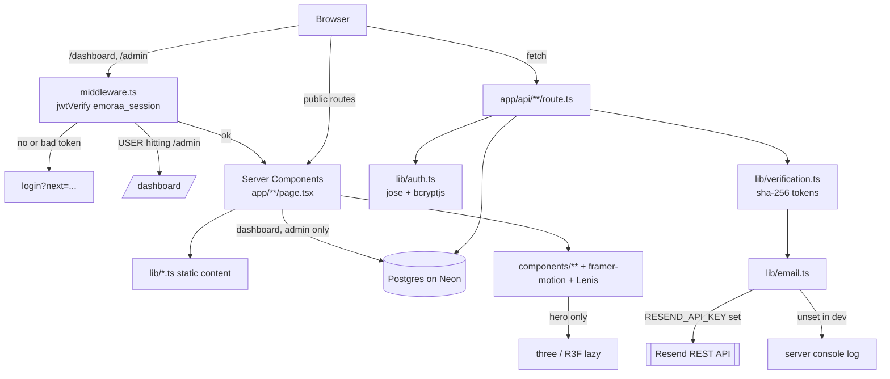
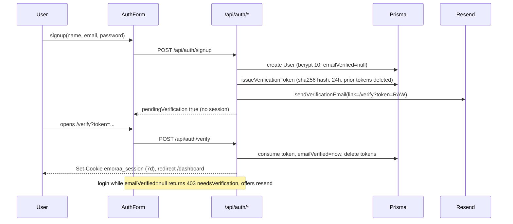
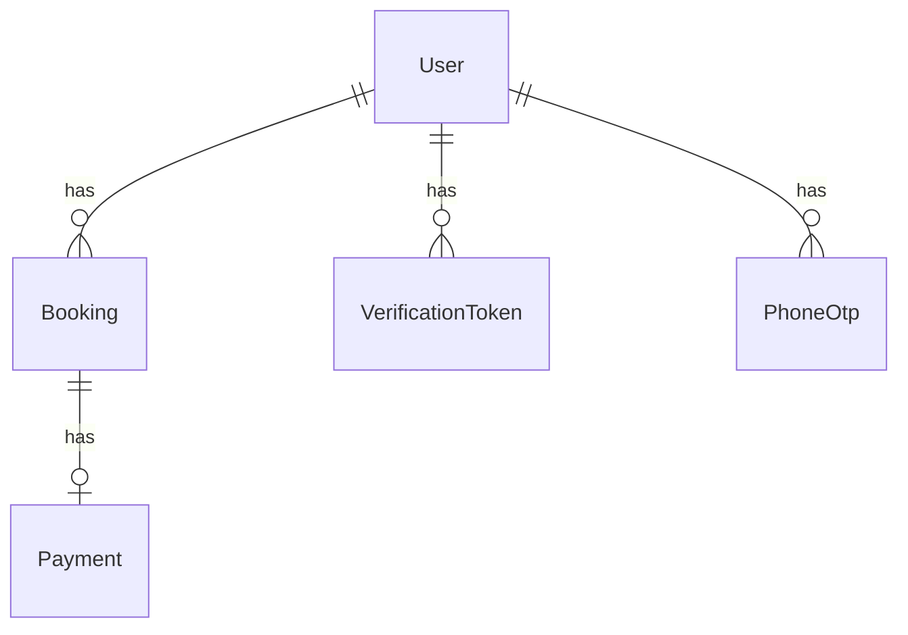

# CODEBASE_CONTEXT.md

> Canonical memory + map of this repository. **Read this first.** Product truth (users, positioning,
> evidence, principles) lives in [PRODUCT.md](PRODUCT.md); read it before design or copy work. Only open source
> files listed under *Change Impact Map* / *File Importance Ranking* for the specific
> change you're making. Do not rescan the repo unless architecture changed.
> Last full scan: 2026-08-27 · branch `Tarush` · 1 commit (`1b29a2d Initial commit`).
> Renamed 2026-08-30: **mann Matters → Emoraa** (domain `emoraa.com`, with `emoraa.in` and `www.` redirecting to it, cookie `emoraa_session`,
> booking refs `EM-`). The two pre-rename bookings were renumbered to `EM-` on
> 2026-10-01; both belonged to the owner's own accounts, so no client was
> holding a receipt that stopped matching.
> Last updated: 2026-09-04 — booking feature boundary introduced; client journey build-out (payments, reschedule, profile,
> real availability, state coverage, security hardening). Sections revised: Tech Stack,
> Project Structure, Architecture, Core Modules, API Reference, Database, Business Rules,
> Testing, Known Technical Debt, Change Impact Map, File Importance Ranking, Glossary.

---

## Session Bootstrap

Everything needed to start work with no extra reading:

- **What**: `Emoraa` — Next.js 14 App Router marketing site + booking
  product for therapy, counselling and psychiatry (students, professionals, anyone; usable from anywhere). Serene, editorial, "boutique
  commission not template" visual bar.
- **Root**: `c:\Users\dell\Desktop\Emoraa` · Windows · PowerShell primary.
- **Run**: `npm install` → `npm run dev` (:3000). Build `npm run build`; serve `npm start`.
  Checks: `npm run typecheck`, `npm test` (unit), `npm run test:integration` (needs a running server).
  No lint script; ESLint is **disabled at build** (`next.config.mjs`).
- **DB**: PostgreSQL on **Neon** via Prisma 6 (since 2026-10-08; was SQLite). `DATABASE_URL` = pooled
  URL, `DIRECT_URL` = direct URL (migrations). Separate Neon branches: `dev` locally, main only in
  production. Schema changes are **migrations** in `prisma/migrations/` (`npm run db:migrate` locally,
  `npm run db:deploy` on deploy); never `db push`. `npm run db:seed` creates the admin.
  Tables include `User`, `VerificationToken`, `PhoneOtp`, `Booking`, `Payment`, `RateLimit`.
- **Auth**: email + password or verified phone + one-time code. Both issue a JWT (`jose`, HS256)
  in the httpOnly cookie `emoraa_session`, 7-day TTL. `middleware.ts`
  guards `/dashboard/*` and `/admin/*`. Roles `USER` | `EXPERT` | `ADMIN` (string column, not an enum — a holdover from SQLite).
- **Import alias**: `@/*` → repo root. Strict TS, `noEmit`.
- **Data model**: content (experts, services, posts, tools, testimonials, faqs, helplines)
  is **static typed TS in `lib/`**, not a CMS/DB. Only users/bookings/payments/tokens are persisted.
- **Booking invariant**: a slot is held by the UNIQUE `Booking.slotKey` (`expertId|date|time`);
  releasing it is `slotKey = null`. Availability is *derived* from that column. Never add a
  second source of truth for availability — verified: 6 parallel holds → exactly 1 winner.
- **Booking lifecycle**: `PENDING_PAYMENT` (slot held ~15 min) → `CONFIRMED` on payment
  → `CANCELLED`; or → `EXPIRED` if the hold lapses unpaid. Holds are swept lazily by
  `releaseExpiredHolds()` on every availability read and competing write — there is no cron.
- **All policy lives in `lib/features/booking/policy.ts`** (IST math, 24-hour change window, refunds,
  hold TTL, max reschedules). Client and server both import it, so copy and logic agree.
- **Styling**: Tailwind + brand tokens in `tailwind.config.ts`; shared component classes
  (`.wrap`, `.page-top`, `.eyebrow`, `.h-display`, `.prose-mm`, `.link-draw`, `.card-lift`)
  in `app/globals.css`. Use these — do not re-invent spacing/typography.
- **Motion**: framer-motion everywhere + Lenis smooth scroll. Every animation must honor
  `prefers-reduced-motion` (already wired via `MotionConfig reducedMotion="user"`).
- **Money**: INR, `formatINR()`. **Dates**: `YYYY-MM-DD` strings, times `HH:mm`, always IST —
  use `todayIST()` / `sessionStart()` from `lib/features/booking/policy.ts`, **not** `utils.todayISO()` (server-local).
- **Payments are simulated** (`lib/payments.ts`) with deterministic triggers, swappable for a
  real gateway by keeping `charge()`'s signature. Card PAN/CVV are never stored or logged —
  only brand + last4.
- **Safety rule (product-critical)**: this is *not* a crisis service. Crisis routing to
  Tele-MANAS `14416` / emergency `112` must remain reachable from every page
  (`SafetyNotice`, `ChatAssistant`, `/crisis`). Never remove or bury it.
- **Not deployed yet**: no Dockerfile, no vercel.json. Vercel-ready by convention. CI is GitHub Actions
  (`.github/workflows/ci.yml`) — see Testing.

---

## Repository Overview

- **Purpose**: Marketing site + self-serve booking for online therapy, plus a suite of
  free self-help tools and an editorial blog.
- **Business domain**: Mental health / teletherapy, India. B2C (individual, couples,
  student pricing) + B2B (`/for-organisations`: colleges, corporates).
- **Primary user flows**
  1. Land → browse/tools/blog → `/book` → **auth gate first** → concern → expert →
     live slot → review → hold → pay → confirmation.
  2. Signup → email verification link → auto-login → `/dashboard` (view, pay, move, cancel)
     → `/dashboard/profile` (details, password, "what we hold about you").
  3. Admin login → `/admin` (client roster, booking + payment stats, search).
  4. Anonymous tool use (`/breathe`, `/check-in`, `/match`, `/tools/*`) — no auth, no server.
  5. Crisis path → `SafetyNotice`/`ChatAssistant`/`/crisis?sos=true` → helplines.
- **Key architectural decisions**
  - App Router; **server components by default**, `"use client"` only for interactive leaves (~45 files).
  - Content-as-code in `lib/` (single source per domain object; UI never re-declares data).
  - Auth is DIY (jose + bcryptjs), no NextAuth. Session claims carry `role` so middleware
    can gate without a DB hit.
  - Tools are 100% client-side and privacy-preserving (journal → `localStorage` only), but they
    now sit **behind a sign-in gate**. See "Free tools need an account" below.
  - Availability is **real**, derived from the UNIQUE `Booking.slotKey`; the constraint —
    not a read-then-write check — is what prevents double booking.
  - The booking flow gates on auth **before** asking about a concern: health information is
    never entered into a form that could bounce to a login, and never put in browser storage.
  - Payment is a swappable simulator (`lib/payments.ts`) with deterministic failure triggers,
    so every failure screen is reachable on demand rather than by waiting for a real decline.
  - Route handlers return a stable `{ error, code, fields? }` envelope and `no-store`;
    ownership failures are reported as 404, never 403, so ids can't be probed.
  - `dynamic = "force-dynamic"` on `/dashboard`, `/dashboard/profile`, `/admin`, `/book`,
    and all `/api/*`; everything else static/SSG.

---

## Tech Stack

| Layer | Choice |
|---|---|
| Language | TypeScript 5.6 (strict), some `.mjs` (seed, next config) |
| Framework | Next.js 14.2 App Router, React 18.3 |
| Styling | Tailwind 3.4 + custom tokens, PostCSS, autoprefixer |
| Motion | framer-motion 11, lenis 1.1 |
| 3D | three 0.169, @react-three/fiber 8, @react-three/drei 9 (hero only, lazy) |
| DB | PostgreSQL (Neon) + Prisma 6 (`@prisma/client`), migrations in `prisma/migrations/` |
| Auth | jose 6 (JWT HS256), bcryptjs 3 (cost 10) |
| Avatars | @dicebear/core + collection 9 |
| Email | nodemailer (Gmail SMTP) → Resend REST → console fallback, in that order |
| Fonts | next/font Google: Fraunces (display), Plus Jakarta Sans (sans), Tiro Devanagari Hindi (देवनागरी) |
| Images | next/image; remote allowlist: `images.unsplash.com` only |
| Payments | simulated in-house (`lib/payments.ts`); no gateway SDK |
| Security | per-route rate limiting (shared Postgres counters, `RateLimit` table), same-origin checks, security headers in `next.config.mjs` |
| Build / tests | next build · Vitest (unit + integration) · GitHub Actions CI (see Testing) |

---

## Project Structure

### `app/` — routes (App Router)
- `layout.tsx` **critical**: fonts, metadata/OG defaults, global chrome (`Providers` → `Navbar`,
  `main`, `Footer`, `WhatsAppButton`, `ChatAssistant`, `SafetyNotice`).
- `template.tsx`: per-route fade+rise transition.
- `globals.css` **critical**: base + `@layer components` shared classes + reduced-motion guards.
- `page.tsx`: home = ordered composition of 12 `components/sections/*`.
- Public pages: `services/`, `for-organisations/`, `about/`, `contact/`, `made-in-india/`,
  `crisis/`, `blog/` + `blog/[slug]/` (SSG), `not-found.tsx`.
- Tool pages: `breathe/`, `check-in/`, `match/`, `tools/` index + `tools/{grounding,relax,sounds,affirmations,sleep,journal,bmi}`.
- Auth pages: `login/`, `signup/` (both render `AuthForm`), `verify/` (renders `VerifyClient`).
- Gated pages: `dashboard/`, `admin/` — server components, direct Prisma reads, `force-dynamic`.
- SEO: `sitemap.ts` (manual static route list + posts), `robots.ts`, `icon.svg`.
- `api/` — see *API Reference*.

### `components/`
- `layout/TalkToManuButton.tsx`: the WhatsApp CTA, framed as a person not a channel —
  WhatsApp glyph in its own #25D366 (recolouring it kills recognition) + a live presence dot
  + a `free · any hour` note. Used in the hero; `label`/`note` props make it reusable.
  **Not** used on `/crisis`, deliberately — see Business Rules.
- `layout/`: `Navbar` (350 L; polls `/api/auth/me` on every pathname change), `Footer`
  (newsletter = stub), `Providers` (Lenis + MotionConfig), `WhatsAppButton`, `SafetyNotice`, `BackButton`.
- `sections/`: home/page sections. **Orphans (unused): `ServicesPreview`, `WhatsAppCompanion`
  (which is the only consumer of `WhatsAppChat`).**
- `booking/`: `BookingFlow` (5-step machine + auth gate + confirmation), `SlotPicker`
  (live availability, loading/empty/error states), `PaymentPanel` (method choice, validation,
  failure + retry, hold countdown), `BookingCard` (every booking state), `RescheduleDialog`,
  `CancelBookingButton` (refund shown before the decision).
- `profile/`: `ProfileForm` (name, phone, language, therapist note), `PasswordForm`.
- `auth/`: `AuthForm` (login+signup in one, `mode` prop), `VerifyClient`, `LogoutButton`.
- `analytics/AnalyticsProvider`: PostHog pathname-only public page views; no autocapture or replay.
- `blog/`: `BlogIndex`, `PostCover`, `ArticleContents`, `ReadingProgress`, `ShareRow`.
- `tools/`: one component per tool + `ChatAssistant` (global, stateless Claude-backed API)
  + `TherapistMatcher`.
- `TryManu/`: `TryManuDemo` (scripted WhatsApp-bot demo; `/api/manu-demo` supplies its
  lightweight live fallback), `TypingDots`, `scenarios.ts`.
  **Trilingual**: `scenarios.ts` holds every thread in `en` / `hi` / `hinglish` (`Lang`), plus a
  `UI` record for the card's chrome. Default `hinglish`; choice persisted to `localStorage`
  under `emoraa.manu.lang`. Switching **converts the visible bubbles in place** (mapped by
  `script: {scenario, index}`) rather than replaying — a visitor's own typed text is never
  rewritten. `playThread` re-reads `langRef` each step, so a switch mid-animation carries.
  **Invariant**: a scenario's threads must be parallel across languages (same length, same
  roles by index); `assertParallelThreads()` logs drift in dev, stripped in prod.
- `organisations/`: `SegmentGrid` (the six institution cards, each with a photograph and its
  own "Build a pack for us" trigger), `PackBuilder` (the enquiry composer — focus trap, Escape
  to close, focus restored to the opener), `PackCta` (page-level trigger). These replaced a
  `mailto:` template that silently did nothing on any device without a mail client.
- `visuals/`: the canvas family. `useCanvasScene.ts` holds the shared machinery
  (hi-dpi sizing, ResizeObserver, rAF loop, pointer, reduced-motion) plus `PALETTE`/`rgba`/`mix`,
  so a new scene is only its drawing code. Scenes: `NodeBuilding` (`/for-organisations` — a stack of
  **cantilevered volumes** in axonometric projection (`project()` maps x/height/depth to canvas,
  so boxes have real tops and sides). One volume per entry in `pillars`; corners are nodes, edges
  beams, front faces carry window-node grids. Colour grades amber-gold at street level → lime →
  deep forest at the roof. Click a volume: its windows light in sequence, then the light carries
  up and down the stack one storey at a time), `Weave` (parity-grid handloom, `/made-in-india` — click throws a gold
  weft), `InkLines` (`/blog` — the page writing itself: a
  nib crosses left to right and word-clusters of nodes land behind it, one line per entry in
  `lib/posts.ts`, **length = read time**, **colour = category**; click a line and it rewrites
  from the start with an ink-drop ripple. The blog page had no hero section, so one was added
  following the placement contract below), `ChaiSteam` (`/about` — a cutting-chai glass in
  nodes (elliptical rim and base, tea visible inside) with coiling steam **wisps**: each is a
  continuous strand whose sway grows with height, and whose brightness travels up it so it
  reads as rising. An earlier particle-scatter version looked like specks, not steam.
  From that page's own "as ordinary as asking for chai"; click pours another), `IndiaOutline` (`/made-in-india` — an outline map of India drawn as a
  **continuous line** that traces itself around the country, colour shifting through the
  palette as it travels, nodes set along it. Click to redraw.
  **`BORDER` is real survey data**, not hand-authored: DataMeet's `india-composite` GeoJSON
  (official outline, full claimed J&K extent), 242k points decimated then Douglas-Peucker'd
  to 400. Three earlier attempts at authoring the coastline from memory all failed — do not
  hand-edit the coordinates, re-derive from the source. Also: rendering the border as loose
  dots does not read as a country; it has to be a line), `Ripples` (`/contact` — small drops opening into wide rings,
  for "No question is too small"; sits **full-bleed behind both columns** because the form
  occupies the right side, and drops arrive unprompted so the surface is never dead),
  `WayThrough` (decaying-noise lanes, `/services` — one lane per entry in
  `lib/services.ts`, agitated and colourless on the left, settling into **its own colour** on
  the right, per the page's own headline; **colour = which format** (rose/indigo reuse the
  brain's limbic/frontal hues so the palettes agree across pages), **strand count = people in
  the room**, **lane length = session duration**. Click fires a four-stage sequence: burst ring
  at the cursor → lit front travelling the lane and calming it → arrival flare → ease back).
  `ScriptConstellation` (`/therapists` — the care team as the languages they speak: one star per
  practitioner in their card's hue, orbited by a letter from each script in their `languages` (ह, த, അ, અ…;
  unknown languages fall back to their initial). Threads join people who share a *rarer* language — any
  language more than half the team speaks, and English, gets none — and that letter travels along them.
  Hover a letter: its speakers lean in, the rest step back, and the language is named in its own script.
  Click holds the selection. Fonts: `--font-deva` / `--font-display`, then the device's Indic fonts).
  Each uses a *different mechanic* from the brain on purpose, not a different silhouette.
  **Reduced motion must freeze *position*, not just progress** — a scene that stops advancing
  its own clock but still reads live `t` for sway, or derives age from `performance.now()`, keeps
  animating. Both slipped through once; the check is two canvas screenshots 1.3s apart under
  `reducedMotion: "reduce"` being byte-identical.
  **Scene state must live in a `useRef`**, never in component-body locals — a re-render resets
  them and clicks fail a bounds check silently.
  **Placement contract** (all three heroes, copied from the home hero): canvas in a
  `pointer-events-none` wrapper with a `pointer-events-auto` inner; the hero's content column
  gets `pointer-events-none` with `pointer-events-auto` back on its control row; and every
  decorative `absolute inset-0` wash in that section needs `pointer-events-none` or it silently
  eats every click meant for the canvas.
- `three/NeuralBrain.tsx`: 2D canvas (not three.js despite the folder). **No longer mounted on
  the home page** — see "the hero is a photograph" below. Kept, and still exported.
  **Eight brain regions, each with a feeling and its own colour** (`REGIONS[].rgb`).
  Colour is *earned by interaction*: at rest nodes are tinted only ~20% toward their region
  (stays serene behind the headline); hover blooms one region; **click sends a BFS wave whose
  pulses take the colour of the region they arrive in**, so a thought is seen crossing from
  focus → feeling → memory → calm. Also: comet-trailed pulses, gradient synapses between
  regions, cursor magnetism, region-coloured rings.
  **A11y**: the canvas is `aria-hidden`, so 8 `pointer-events-none` buttons overlay it —
  keyboard/screen-reader only (tab a region, Enter fires it); the mouse uses the canvas.
  **Reduced motion** stops movement but keeps colour feedback (click flashes the region
  instead of animating a wave) — the loop always runs.
- `ui/`: `Button`, `Reveal` (scroll reveal, used ~31×), `FloatingOrbs`, `SectionHeading`,
  `Accordion`, `CountUp`, `Avatar`, **`Field`** (Field/TextArea/Select with label+error+aria
  wiring), **`Feedback`** (`Spinner`, `Skeleton`, `BookingCardSkeleton`, `EmptyState`,
  `Alert`, `CrisisLine`).
- `icons/ToolIcons.tsx`: `TOOL_ICONS` map resolving `Tool.icon` keys → SVG.

### `lib/` — data + logic (no React)
- **Feature modules**: `features/booking/policy.ts` is isomorphic; `features/booking/server.ts`
  owns slot holds, sweeps, ownership, and serialization. (The old root `booking-policy.ts` /
  `bookings.ts` compatibility exports have been removed; import from `features/booking/*`.)
- **Server-only**: `auth.ts`, `db.ts`, `verification.ts`, `email.ts`,
  `payments.ts` (gateway simulator),
  `http.ts` (response envelope, no-store, same-origin, safe logging), `rate-limit.ts`.
- **Isomorphic (client + server)**: `features/booking/policy.ts` (**the rules**), `validation.ts`
  (field rules), `payment-fields.ts` (Luhn, masking), `matching.ts`, `utils.ts`.
- **Static content**: `experts.ts`, `services.ts`, `posts.ts`, `tools.ts`, `testimonials.ts`,
  `faqs.ts`, `organisations.ts`, `site.ts`, `service-details.ts`, `therapy-pages.ts`.

### `prisma/` — `schema.prisma`, `migrations/` (committed; the schema's history), `seed.mjs`. An old SQLite `dev.db` may linger locally (gitignored, unused).
### `public/` — `reviews/` (30 pngs), `team/`, `sounds/`. `assets/avatars/` — source art.
### `.claude/` — `launch.json` (next-dev debug), `settings.local.json` (permission allowlist).

**Dependency direction**: `app/*` → `components/*` → `lib/*` → (`@prisma/client`). `lib/` never imports components.

---

## Architecture



**Request flow**: request → `middleware.ts` (matcher `/dashboard/:path*`, `/admin/:path*` only)
→ RSC render (may read Prisma directly) → HTML. Client interactivity calls `/api/*` route
handlers, which re-check `getSession()` server-side — middleware is a convenience, never the
authority. Every state-changing handler additionally checks the request Origin.

**Booking flow** (the spine of the product):

```mermaid
sequenceDiagram
  participant U as User
  participant F as BookingFlow
  participant A as API
  participant D as Postgres
  U->>F: opens /book
  Note over F: auth resolved server-side; logged out sees the gate, not the form
  U->>F: concern, expert
  F->>A: GET /api/availability
  A->>D: sweep lapsed holds, read slotKey column
  A-->>F: free / taken times
  U->>F: picks a time, reviews
  F->>A: POST /api/bookings
  A->>D: INSERT with slotKey (UNIQUE)
  alt slot already held
    D-->>A: P2002
    A-->>F: 409 SLOT_TAKEN + fresh availability
  else granted
    A-->>F: PENDING_PAYMENT, hold ~15 min
    U->>F: pays
    F->>A: POST /api/payments
    A->>A: charge() - PAN used, then dropped
    alt gateway declines
      A->>D: Payment FAILED, attempts++
      A-->>F: 402 + reason + retryable; hold kept
    else paid
      A->>D: Payment PAID, Booking CONFIRMED, hold cleared
      A-->>F: confirmation
    end
  end
```

**Data flow**: static content flows `lib/` → server component → props → client leaf.
Mutable state flows client `fetch` → route handler → Prisma → Postgres, and comes back through
`serializeBooking()`, a column allow-list. Tool state never leaves the browser.

**Auth flow**



**Event flow**: none server-side (no queues, cron, or webhooks). Client "events" are
framer-motion viewport reveals, the Lenis rAF loop, and `Navbar`'s `/api/auth/me` refetch on
`usePathname()` change.

---

## Core Modules

### `lib/auth.ts` — sessions (**critical**)
- Exports `SESSION_COOKIE="emoraa_session"`, `Session`, `hashPassword`, `verifyPassword`,
  `createSession`, `getSession`, `clearSession`.
- JWT claims: `sub`=userId, `name`, `email`, `role`. HS256 over `AUTH_SECRET`. `MAX_AGE` 7d.
- Cookie: httpOnly, sameSite lax, `secure` in production, path `/`.
- Uses `next/headers cookies()` → **server-only**. Throws if `AUTH_SECRET` unset.
- `middleware.ts` duplicates the verify logic with `jose` directly (Edge runtime; cannot import `lib/auth`).

### `lib/verification.ts` — email confirmation
- 32-byte random hex token; **only the sha-256 hash is stored**; TTL 24 h.
- `issueVerificationToken` deletes all prior tokens for the user (newest link wins).
- `consumeVerificationToken` is one-time use; expired → delete + return null.

### `lib/phone-otp.ts` + `lib/sms.ts` — phone sign-in
- Six-digit codes use `crypto.randomInt`, expire after 5 minutes, allow 5 attempts, and are
  stored only as an HMAC-SHA256 hash keyed by `AUTH_SECRET`.
- Challenges are single-use and bound to both the user and exact normalized phone number.
- A profile phone must be confirmed before `/api/auth/phone/*` will recognize it.
- Twilio sends production SMS. Without Twilio, non-production responses include `devCode`;
  production returns 503 rather than exposing an OTP.

### `lib/email.ts` — delivery (three providers, tried in order)
- `sendVerificationEmail(to, name, link)` → `DeliveryResult {delivered, via, devLink?}`.
- **Gmail SMTP** (`GMAIL_USER` + `GMAIL_APP_PASSWORD`) → **Resend** (`RESEND_API_KEY`) →
  **console**. Gmail wins when both are set, and forces the From header to the authenticated
  account — Google will not let you send as anyone else.
- With neither configured: logs the link to the server console and returns it as `devLink`,
  **only when `NODE_ENV !== "production"`**. `/api/auth/signup` and `/api/auth/resend` pass it
  through, and `AuthForm` renders it in a "Development only" panel. Without this, signup is a
  dead end on a machine with no mail credentials — which is exactly what it was.
- `mailerConfigured()` reports whether a real provider is wired up; signup uses it to say
  "no email could be sent" instead of "check your inbox".
- Signup swallows mailer throws so a delivery failure never loses a just-created account.

### `lib/db.ts` — Prisma singleton cached on `globalThis` in non-production.

### `lib/experts.ts` — booking vocabulary (**critical, shared client + server**)
- `experts: Expert[]` (6 therapists: id, credentials, languages, specialties, price 899–1499,
  rating, Unsplash photo).
- `concerns` (`as const`, 6: anxiety | stress | relationships | career | sleep | other) + `ConcernId`.
- `timeSlots`: Morning/Afternoon/Evening, 12 slots total, `HH:mm`.
- **`POST /api/bookings` validates against these arrays** — editing them changes what is bookable.

### `lib/matching.ts` — therapist matching
- `concernMap` (a *second*, matcher-specific concern vocabulary — ids overlap `experts.concerns`
  but add `depression` and drop `other`), `languageOpts`, `budgetOpts`.
- `rank(concernKeys, language, budget)`: specialty match +4, language +2, budget +2,
  `rating − 4.5` tiebreak. Substring match on lowercased specialties.
- `expertsFor(keys)`: filter + sort by rating desc.

### `lib/posts.ts` — blog CMS-in-code
- `Post` with block content (`p | h2 | quote`), category union, takeaways, linked tool.
- `getPost(slug)`, `headingsOf(post)`, `headingId(text)` (slugified anchors), `categories`.
- Consumed by `blog/[slug]` `generateStaticParams`/`generateMetadata`, `BlogIndex`, `sitemap.ts`.

### `lib/tools.ts` — free-tool catalogue
`inlineOnHome = ["/breathe","/check-in"]`, `railTools` = the rest. One source for `/tools`
and the home rail. `icon` is a key resolved by `ToolIcons`.

### `lib/site.ts` — brand constants, WhatsApp deep link, `helplines[]` (8 verified Indian
helplines; Tele-MANAS and 112 flagged `primary`), `navLinks`, `toolLinks`, `stats`.

### `lib/features/booking/policy.ts` — **the rules** (isomorphic, **critical**)
- Constants: `HOLD_MINUTES` 15, `FREE_CHANGE_HOURS` 24, `MAX_RESCHEDULES` 2, `HORIZON_DAYS` 14,
  `SESSION_MINUTES` 50. Status enums for booking and payment.
- IST time: `sessionStart(date,time)` applies `+05:30` explicitly, so the server's own timezone
  never changes an answer. `todayIST()`, `istDateOffset()`, `bookableRange()`, `hoursUntil()`.
- `slotKey(expertId,date,time)` — the value the UNIQUE column holds.
- Decisions: `validateSlot`, `canCancel`, `canReschedule` — each returns
  `{ok} | {ok:false, code, reason}` where `reason` is user-facing prose.
- `refundFor()` — full refund outside the window, none inside, nothing if never paid.

### `lib/features/booking/server.ts` — server-side booking mechanics
- `releaseExpiredHolds()` (lazy sweep), `dayAvailability()`, `takenSlots()`.
- `findUserBooking(id, session)` — the single ownership gate; a mismatch returns null so the
  caller answers 404 rather than 403.
- `createBookingWithRef()` — retries only on a `ref` collision, never on a slot collision.
- `isUniqueViolation(err, field)` — P2002 narrowed to a column.
- **`serializeBooking()`** — the client-facing allow-list. A new schema column is invisible to
  the browser until deliberately added here.

### `lib/calendar.ts` — calendar export
- Builds dependency-free RFC 5545 `.ics` events from booking date/time, converts IST to UTC,
  includes an optional meeting URL and a 30-minute reminder, and excludes the concern.
- `/api/bookings/[id]/calendar` reuses `findUserBooking()` and serves confirmed sessions only.

### `lib/payments.ts` — gateway simulator (server-only)
- `charge({method, amount, card?, vpa?})` → `{ok, reference, cardBrand, last4, vpaMasked}` or
  `{ok:false, failure:{code, message, retryable}}`. Deterministic trigger cards, documented in
  the file — they are Luhn-valid on purpose.
- PAN and CVV enter and are dropped; nothing here is logged. `refund()` returns a reference.

### `lib/http.ts` — response contract
- `privateJson()` / `fail()` / `errors.*` — every response `no-store`, every error
  `{error, code, fields?}`. `isSameOrigin()`, `clientKey()`, `readJson()`, `logFailure()`
  (message only, never a person or a secret).

### `lib/rate-limit.ts` — shared fixed-window limiter (Postgres)
- `LIMITS`: login 8/10min, signup 5/hr, resend 4/hr, verify 12/10min, payment 10/10min,
  booking 20/10min, password 6/hr, forgot 4/hr, reset 10/hr, enquiry/contact 20/hr, feedback 10/hr,
  Manu 20/10min, coupon 15/10min. `await rateLimit()`; `resetLimit()` clears a bucket after a genuine success.
- Counters live in the `RateLimit` table, so every instance shares them; identifiers are HMAC'd with
  `AUTH_SECRET` before storage. Fails open if the database is unreachable.

### `lib/validation.ts` / `lib/payment-fields.ts` — shared field rules
- Imported by the form and the handler both, so an inline message and a server rejection can't
  disagree. Phone parsing tolerates spaces, dashes, `+91`, leading `0`. Masking helpers
  (`maskEmail`, `maskPhone`, `maskVpa`, `formatCardDisplay`) live alongside.
- `STATE_OPTIONS` (28 states + 8 UTs) and `LANGUAGE_OPTIONS` are allow-lists; `validateCity`
  rejects by exception instead (digits and markup), so every Indian script passes.

### `lib/admin-period.ts` + `components/admin/PeriodPicker.tsx` — the time filter
- **One resolver for every admin screen that filters by time.** `resolveRange(searchParams)`
  turns `?period=week` or `?from=&to=` into a `Range`: a pair of `YYYY-MM-DD` dates in clinic
  time, the matching IST-midnight instants, a label and a day count. Nothing downstream needs
  to know whether a preset or a typed range produced it.
- `dateWhere(range)` filters a `YYYY-MM-DD` string column (bookings); `instantWhere(range)`
  filters a real timestamp (clients, audit). `toAt` is the first instant **after** the last
  day, so an 11pm IST signup on the final day is inside the range.
- **Everything is clamped, never rejected**: a future `to` comes back to today, a `from` before
  2020 to 2020, a reversed pair is swapped, junk falls back to the preset. A filter is a view,
  and a view that 500s because somebody typed a date in 1823 is worse than one that shows what
  it can. `tests/unit/admin-period.test.ts` holds the cases.
- `rangeParams(range)` carries the current range into a link that changes something else, so
  picking a zoom or a status does not silently reset the dates.
- The picker uses native `<input type="date">` — the platform's calendar, keyboard and locale
  for free, and nothing added to the bundle. `today` is passed from the server: the browser's
  clock is in the visitor's timezone, and an admin in London must not be offered "tomorrow".
- On `/admin/insights`, **four panels deliberately ignore the range** (retention, free-session
  conversion, languages) and say so on screen. A fortnight cannot tell you whether anybody came
  back, so scoping those would produce a confident wrong answer.

### `lib/admin-clients.ts` / `lib/admin-payments.ts` / `lib/admin-status.ts` — admin data
- `admin-clients` backs the directory and the one-client page: sessions, no-shows, cancellations
  and spend, in three grouped queries rather than one per row. It selects an allow-list and
  **never** `notes` or the intake form — clinical, and not an admin's to read.
- `admin-payments` has `listPayments` (by status) and `moneyLeftOnTheTable`: a pending or failed
  payment on a session whose date has passed, i.e. time a practitioner may have given for free.
  A booking sitting at PENDING while somebody types their card in is not a debt, so the date
  filter is what makes the list mean anything.
- `admin-status` maps a stored status to its label and tone once, so the screens cannot call the
  same row "awaited" on one page and "unpaid" on the next.

### Booking is request-first (changed 2026-10-11)
A booking no longer confirms on payment. The states are
`REQUESTED → PENDING_PAYMENT → CONFIRMED`, with `DECLINED` and `EXPIRED` as the exits.

- **The client asks.** `createBooking` / `createProBonoBooking` both open at `REQUESTED`, holding
  the slot, with a `PENDING` payment row so every screen that reads `payment` still has something
  honest to show. **Nothing is charged.**
- **`/api/payments` refuses a REQUESTED booking** (`409 AWAITING_THERAPIST`). That is the gate for
  the whole flow: without it a client with the payment screen open could pay for a session nobody
  has agreed to.
- **The practitioner answers.** Accept → `PENDING_PAYMENT` (or straight to `CONFIRMED` if free,
  since there is nothing to pay) and the client is emailed a link. Decline → `DECLINED`, the slot
  is released immediately, and a reason is required. **The reason is never shown to the client** —
  it is written for the record, and "not a good fit for my caseload" reads very differently to the
  person it is about.
- **Nobody answers** → `releaseExpiredHolds()` expires it. `requestExpiry()` is 24 hours, or two
  hours before the session, whichever is sooner: a request for tomorrow morning cannot sit for a
  full day.
- **Colour**: `BOOKING_STATUS_META` / `statusMeta()` in `lib/expert-portal.ts` — yellow waiting,
  green agreed, red declined, each with a label, because colour alone is no use to a screen reader.
  `StatusBadge` now takes `ViewStatus` (every status a booking can be *in*) while `SessionStatus`
  stays the narrower set a practitioner may *set*.

### The expert portal
- `/expert` leads with **Waiting on you** — the request board, accept in one press, decline behind
  a reason.
- `/expert/earnings` (`lib/expert-earnings.ts`) — their **share**, never gross: earned / received /
  awaited, plus what clients still owe. Every query is scoped by the `expertId` from the session.
- `/expert/sessions` gains **Today** and **Waiting on you** filters and a date range. It resolves
  the range with `allowFuture: true` and defaults to all time — a 30-day default would open the
  page on an empty "Upcoming".
- The session page shows the client's **name, age, gender and preferred language** (the lists stay
  masked), their **history with this practitioner only**, and **Suggest a follow-up**.
- **Follow-ups** (`FollowUp` model): one live suggestion per practitioner per client, a second
  inside a week is refused. It books nothing — a therapist who could put sessions in a client's
  calendar would be one the client could not easily say no to.
- **Quiet hours are gone** (migration `drop_expert_quiet_hours`), with the three columns dropped.

### Rescheduling — the practitioner proposes, the client decides
- `POST /api/expert/sessions/[id]/reschedule` stores a `RescheduleOffer` of up to **3 dates × 2
  times** and emails the client. **It moves nothing.** A therapist who could move a client's
  appointment unilaterally would be one whose clients cannot rely on their own calendar; if the
  client never answers, the original time stands.
- The offered slots are **not held** — holding six times to move one session would block most of
  a week for one person. The client's pick is settled against the UNIQUE `Booking.slotKey`, and a
  lost race returns `SLOT_TAKEN` with the offer still open so the other times remain.
- `rescheduleCount` is the client's own allowance of changes and is **deliberately not spent** by
  a move the practitioner asked for.
- Rules live in `lib/reschedule-offers.ts` (`checkOffer`, `wasOffered`, `offerExpiry`), tested in
  `tests/unit/reschedule-offers.test.ts`. An offer never outlives the earliest slot it offers.

### Prescriptions — psychiatrists only
- **The gate is `canPrescribe(profession)` on the route**, not on the screen. A clinical
  psychologist cannot prescribe in India, and a hidden button is not a control. A missing
  medical-council registration number is also refused: a prescription without one is not one a
  pharmacy can act on.
- `prescriberName` / `prescriberCreds` / `registrationNo` are **snapshotted at issue**. Read live
  from the profile, editing that profile would rewrite every prescription issued under it.
- **Nothing is ever edited.** A mistake is withdrawn (with a reason, kept) and replaced, so the
  record shows what was authorised and what withdrew it.
- Numbered `EMR/RX/<fy>/0001`, gapless, from the `ReceiptSequence` table under an `RX-` key so
  the two series cannot collide.
- `looksRestricted()` flags Schedule X / NDPS-style names against the Telemedicine Practice
  Guidelines but **does not block** — the prescriber is the accountable professional. The list is
  indicative and the form says so: **an unflagged drug has not been cleared by anything.**
- Rendered at `/prescription/[id]` as a print-styled page, like receipts — no PDF library. Readable
  by the patient, the prescriber and an admin; anyone else gets a 404, because a 403 would confirm
  the prescription exists.
- **Nobody can prescribe today**: the catalogue has no psychiatrist and no registration numbers.
  The feature is dormant until a real, verified prescriber is added.

### Home: the hero brain, unlabelled, in a grid (2026-10-20)
- **The brain is in the hero, with `labels={false}`.** The eight concern words moved to
  `components/sections/Concerns.tsx`; the label markup in `NeuralBrain` stays, behind the prop,
  because a labelled brain is still right somewhere with room for it.
- **It was never too big.** It was the brain *plus a reserved label column on each side*:
  `brainScale` shrank the silhouette until the widest word on each side fitted. At 1440 the old
  container was 879×900 holding ~594×545 of actual ink — a third of it margin held for text. With
  labels off the container is 579×544 holding 540×498 of ink. **The drawing is only ~9% smaller;
  the footprint is far smaller.** That is the whole answer to "brain too big".
- **The hero is a two-column grid with `items-center`, not layered absolutes.** The old hero could
  not be aligned at all: the brain was `absolute inset-y-0 right-0` while the words sat in a
  separate flow layer, so the two had different vertical centres and every correction was a
  hand-typed number the next breakpoint undid. The browser computes the shared centre now.
  **Do not reintroduce an absolutely-positioned hero visual.**
- The brain's cell has an **explicit height** (`h-[clamp(26rem,42vw,34rem)]` at `lg`). The canvas
  sizes itself to its box, and `h-full` inside an auto-height grid cell has no box to read.
- `brainScale(w, h, labels)` takes the mode: with labels off nothing has to fit beside the
  silhouette, so it fits the drawn ink (500×460) to the box rather than the 600×560 design square.
- **On phones the brain is now its own block below the words**, at full opacity, instead of a
  40%-opacity wash behind the headline that was too small to read as anything.

### Home: "What brings you here" (`components/sections/Concerns.tsx`)
- The eight concerns as eight cards, each a link to the service that handles it — the same links
  they were on the brain, now looking like something you can click.
- **The second line is the point.** "Anxiety" is a clinical word; "worry that won't stop" is what
  a person types at 1 a.m. Four of these were written for the brain; the other four are in the
  same voice. "log kya kahenge" is deliberate — it is the phrase WhyEmoraa answers further down.
- Colour comes from `SERVICE_REGION` in `lib/palette.ts` for six of the eight. Two deviate and the
  file says so: Anxiety and Low mood both lead to individual therapy, and two identical cards in
  one grid looks like a bug, so Low mood takes the brain stem and Can't sleep the temporal lobe.
  The colours still mean what the palette says they mean.

### Home: the stories (`components/sections/Testimonials.tsx`, 2026-10-20)
- **A portrait at 264px, not 48px**, beside the quote rather than under it. A centred quote with a
  small round picture beneath it is the most common testimonial layout on the web, and it read as
  exactly that.
- **The halo is the idea.** Each story takes one of the eight brain-region colours from
  `lib/palette.ts` — the same eight the concerns and the services use — and it washes the space
  behind the portrait and, faintly, the whole band. Moving between stories tweens it, so the page
  changes temperature with each person. It is the one thing here that could not be lifted off
  another site, because those colours already mean something on this one. `WHEEL` is a fixed
  order, so a story always gets the same colour.
- **The ring IS the timer.** The autoplay countdown is stroked around the portrait (`pathLength`
  0→1 over `STORY_MS`) instead of a separate bar or a row of dots — a progress element that is
  also the frame costs nothing in the layout.
- **The quote arrives a word at a time out of a blur.** Per-word, not per-line: a line break is a
  property of the viewport, so staggering by line makes the animation change shape when the column
  does. The blur is dropped under `useLiteMotion` — a filter on thirty spans at once is what
  actually costs frames on a phone.
- **The quote marks live inside the first and last word's span.** Each word is an `inline-block`,
  so a loose closing mark is its own wrappable item and dropped onto a line by itself.
- **Everything that implies a sequence renders only from the SECOND story onwards**: the ring, the
  arrows, the counter, the rail of faces, the autoplay and the drag. There is one approved story
  today, and the original fault here was a full carousel — autoplay, swipe, arrow keys, a drawn
  timer line — wrapped around a single item. A control that cannot go anywhere is worse than none.
- It holds still while the pointer is over it or a control inside it has focus, and never autoplays
  under `prefers-reduced-motion` (where the quote is plain text with no per-word spans at all).
  The arrows still work there.
- **The byline.** That single story is from the founder, and it sat under an eyebrow reading "we
  heard you", which reads as a body of client feedback that does not exist yet. The eyebrow is "in
  their words" and the attribution shows *founder* plainly. Stories still come only from approved
  `Feedback` rows — no written samples; a made-up review is a fake review however kindly written.

### Size Lab — resizing things in the browser (`components/dev/SizeLab.tsx`)
- A development-only overlay for the "that card is too big" problem, which is obvious on screen
  and tedious to describe in words. Ctrl/Cmd + Shift + L, or the pill at the bottom of the window.
- **Click lands on the innermost element**, which is almost never what you meant — clicking a card
  hits the `<span>` holding its label. So a click records the whole **ancestor chain** and the
  panel shows it as chips; clicking a chip (or ↑/↓) walks out to the card, the list, the section.
  An edited level is marked `*`.
- Knobs: a **Scale** row (−20 / −10 / +10 %, which moves font size, padding and gap together — the
  "make this smaller" case) and steppers for text, padding, gap, width, height and radius. Edits
  are inline `!important` styles, so nothing is written to disk by the browser and a reload
  discards everything.
- **Drag handles** on the selection box — right edge for width, bottom for height, corner for
  both. Stepping a number is fine when you know the number; most of the time you want it narrower
  *until it looks right*, which the hand decides and the eye confirms. The handles sit inside
  `[data-sizelab]`, so grabbing one never counts as picking a new element.
- **Edit the words** sets `contentEditable` on the element, so copy is retyped in the real face at
  the real size on the real background. While it is open **every shortcut stands down** — without
  that, pressing Del to fix a typo deleted the heading. React owns this DOM, so a re-render (a
  state change, a Fast Refresh save) replaces what was typed: finish an edit, then save.
- **Only properties you actually touched are recorded.** Diffing computed styles against the
  baseline looked simpler and was wrong: rewriting a heading to a longer line made it wrap, so its
  height went 54→109px and the record claimed a height change nobody asked for. `touched` is
  populated by the knobs, the scale row and the handles, and nothing else.
- Knobs: text, padding, gap, width, height, radius, margin, line-height, letter-spacing.
- **Delete** (button, or the Del key) sets `display:none !important` rather than detaching the
  node — reversible, still readable so its `outerHTML` goes into the saved record, and React would
  put a detached node straight back on its next render. Deleted elements are listed in the panel
  and one click brings any of them back; the chain chip marks that level with ✕.
- **Crisis routing cannot be deleted.** `protectedReason` refuses if the selected element is, or
  contains, `[data-safety-notice]`, `/crisis`, `tel:14416`, `tel:112`, or the words Tele-MANAS /
  14416. CLAUDE.md makes that a hard rule, and a tool that can hide the number and then hand over
  a list saying "delete this" is a path straight through it — so the refusal is at the point of
  the action, not a judgement call afterwards. Verified: the delete is refused and the link stays.
- **Apply to code writes the source files** (`lib/dev/apply-design-change.ts`). Exact string
  replacements, in one file, and only when exactly one place in the codebase can be the source of
  that element — two candidates is a refusal, not a coin toss. Everything shows in `git diff`;
  `git checkout` undoes it. **Just note** is the old behaviour, recording without writing.
- **It edits the class that was WINNING at the width you judged it at.** This is the whole
  difficulty. A card reading `p-5 sm:p-6` shows 24px on a desktop because `sm:p-6` applies from
  640px up; stepping it to 20px and rewriting the bare `p-5` produces `p-5` again — a no-op —
  while nothing moves on screen. The first version did exactly that and reported "nothing mapped".
  `setUtility` now takes the viewport, picks the bare class or the largest breakpoint variant
  whose min-width is <= it, and edits that one. Variants above the viewport are left alone and
  reported. State variants (`hover:`) are never candidates.
- px snaps to the named Tailwind step when one lands within half a pixel, else an arbitrary value
  (`text-[13.6px]`). If the utility is not in the class list at all it is appended — which is how
  a radius living in `.card-mm` gets overridden rather than edited at source.
- **One source line can render many elements.** The eight concern cards share one `className` in
  one `.map()`, so narrowing one narrows all eight. The browser counts how many elements share
  the class string and the result says "one source line, 8 elements on the page".
- **Deleting is the strictest path.** It only handles a one-line data-array entry whose first
  quoted word is unique in the codebase — which is how `CONCERNS`, `reasons` and the rest of this
  project's lists are written — and it comments the line out rather than removing it. Anything
  else is refused: "delete this card" can mean removing JSX or removing a row of data, and getting
  that wrong deletes the wrong thing.
- **Every save also appends to `design-changes.jsonl` at the repo root**, applied or not, with the
  before/after of each edit. The browser is a good
  place to decide a number and a bad place to decide which Tailwind class should carry it, so the
  list is applied by hand afterwards. The file is gitignored.
- **The `className` is the handle, not the source map.** `sourceOf` walks React's fiber for
  `_debugSource`, but measured against this build it returns `null` — Next's SWC transform does
  not emit it. The full Tailwind class string is recorded instead, and in this codebase one grep
  on it lands on the exact line. A tag, the element's own text and an nth-of-type DOM path are
  recorded too, for elements whose classes are generic. **Do not start relying on `source`.**
- **Two independent guards keep it out of production**: the component returns `null` unless
  `NODE_ENV === "development"`, and `app/api/dev/size-lab/route.ts` returns a bare 404 before it
  reads the body. The route writes a file from an unauthenticated request, so the UI not
  rendering is not a guard — the route check is.
- The pill sits **bottom centre** because the safety notice and chat launcher own the bottom-left
  and WhatsApp owns the bottom-right.

### Home: one card, everywhere (`.card-mm` / `.card-mm-dark` / `.card-mm-inner`)
- The page had **five card shapes at once** — differing radii, borders at 10/15/20%, a permanent
  shadow on one and none on the next. Any one looked fine; together they read as several sites
  stitched into one page.
- One shape now, in `app/globals.css`: 24px radius, one hairline border, flat at rest, shadow only
  under the cursor. `.card-mm-dark` is the same card on the forest sections. `.card-mm-inner` is
  one step tighter, for anything nested inside a card. A section that needs its own colour sets
  `style` for background and border and takes everything else from the class.
- Section headings are one scale as well: `text-4xl md:text-5xl lg:text-[3.4rem]`, matching
  `SectionHeading`. NotSure was a step smaller and Manu a step different.
- **The trust strip is gone.** It had been reduced to one card reading "2+ languages" after every
  other figure was pulled as unprovable, and a single card centred in a full-width band looks
  worse than no band. `components/sections/TrustStrip.tsx` and the `stats` export in `lib/site.ts`
  are deleted; the rule that killed the figures still stands in a comment there.

### Free tools need an account
- Free, never paid — but every tool requires sign-in: the seven under `/tools/*`, plus `/breathe`,
  `/check-in` and `/match`. The `/tools` menu is deliberately outside the gate so somebody can see
  what is on offer before being asked for an account.
- `components/tools/ToolGate.tsx` (server, checks the session) renders `ToolWall` (client, reads
  `usePathname` for the `next` param) instead of the page. A **wall, not a `redirect()`**: a
  redirect drops someone on /login with no explanation and no route to help, and loses the URL.
- Applied from four layouts — `app/tools/(gated)/layout.tsx` and one each for breathe, check-in and
  match — so a tool added later is gated by default rather than by memory. The `(gated)` route
  group changes no URLs.
- **The wall always carries crisis routing** (Tele-MANAS 14416, 112, and a link to `/crisis`).
  This is not decoration: the gate now stands between a distressed person and the grounding
  exercise, which runs against PRODUCT.md's first principle. `/crisis` is never gated and embeds
  `BreathingExercise` directly, so breathing is always reachable with no account. Asserted in
  `tests/integration/access-control.test.ts`.
- **The journal still stays in `localStorage`.** Requiring an account to open a tool is not a
  reason to store what someone writes in it.
- **The service worker stopped precaching the tools** (`public/sw.js`, cache bumped to `emoraa-v2`).
  Their HTML now varies by account, which is exactly what that file says never to cache — and the
  precache runs on install, when nobody is signed in, so it would have stored a sign-in wall and
  served it offline to a signed-in person. `/crisis` is still precached, so the one page that must
  survive a dead signal still does. The install prompt no longer promises offline tools.

### Printed documents fit one sheet
A practice plan printed on two pages, with the dark footer band cut in half and the
confidentiality line — the most important sentence on it — alone on page two.
- **The document was never too tall.** It measures 828px under print emulation against 1032px of
  A4 at the 12mm margins `@page` asks for. What overflowed was the page's own screen spacing:
  `pb-24` is 96px of empty paper below the footer, and that is what crossed the boundary. Print
  now zeroes bottom padding and margin on `.page-top`, `.wrap` and `.wrap-wide`.
- **`break-inside: avoid` is named on the footer and header too.** It was already on `[data-receipt]`,
  but that is ignored the moment a document is taller than a sheet, and the browser then breaks
  wherever it likes. Naming the bands keeps each one whole.
- Verified by printing to PDF through the browser and counting `/Type /Page`: two pages before the
  change, one after, and the receipt also one. Re-run `scratchpad/printcheck.mjs` after touching
  the print block or any document layout.

### Claims that appear in many places read from one module
Three facts were typed into dozens of files and had drifted apart. Each now has one source, and
`tests/unit/copy-claims.test.ts` fails if a second version appears.
- **Languages — `lib/languages.ts`.** The home page said "8 Indian languages", `/made-in-india` said
  "Hindi and English today", the FAQ said "2+". All three derive from the practitioner roster now.
  Two things the old copy got wrong: English was counted as an Indian language (it is 7, not 8),
  and Telugu and Bengali were promised "through 2026" while nobody on the roster spoke either.
  A language reaches the site only by being in somebody's profile.
- **Price — `lib/price-claims.ts`.** "From ₹599" appeared in ~10 places, but ₹599 is the **student**
  rate; individual therapy is ₹999. Copy now names both, or names ₹999. A single headline figure
  should be the one most readers are charged.
- **The practitioner descriptor — `site.practitionerWord` ("certified").** Three words were in
  circulation. One constant now. The site never says the practitioners as a group hold a council
  registration, because Emoraa does not require one — "licensed" is read in India as exactly that
  claim, so it is not used either.
- **A register is shown per practitioner, not claimed for the group.** `Expert.registrationBody`
  ("RCI" | "NMC" | "STATE" | "") renders on that person’s profile as e.g. "RCI registered", beside
  their number when they have given one. Set by an admin; the API accepts only a value from
  `REGISTER_OPTIONS`, so a crafted request cannot invent a register on a public profile.
  `tests/unit/copy-claims.test.ts` fails if any copy pairs a register with a plural practitioner
  noun — the difference between "RCI registered" under one name and "our RCI-registered
  psychologists", which would be false.
- **Analytics excludes the individual tools** (`AnalyticsProvider`). `/tools` (the menu) is counted;
  `/tools/*`, `/breathe`, `/check-in` and `/match` are not. Which tool somebody opened is a
  mental-health signal, and the `/tools` page promises no tracking — counting them made that untrue.

### Blog: posts are rows, written in the portals
- **`lib/posts.ts` no longer holds posts.** It keeps the shared types, the category list and the
  heading helpers; the posts themselves are `Post` rows read through **`lib/blog.ts`**. The ten
  original essays were moved in by `scripts/import-posts.mjs` (idempotent, matches on slug) and
  their slugs, dates and bylines are unchanged, so no URL broke.
- `prisma/seed-posts.json` is the frozen copy for seeding a fresh environment. It is JSON, outside
  `lib/`, so it cannot be imported by accident as if it were live content — a second copy of a post
  an admin can edit starts lying the moment they edit it.
- **An expert writes and submits; an admin publishes.** An expert cannot publish, including their
  own work and including by calling the admin route directly. These go out under a named clinician
  on a mental-health service, where an unsourced statistic or advice that is wrong for someone in
  crisis is a real harm, so a second person reads it first. Admins publish their own directly — a
  reviewer approving themselves is a formality, not a check.
- **`lib/post-policy.ts` is the single source of the rules**: who may edit, who may delete, and
  every status transition. `lib/post-api.ts` implements the handlers once and both
  `/api/expert/posts` and `/api/admin/posts` mount them, so the two cannot drift apart. The
  editor's buttons come from `movesFor(...)`, the same function the API checks with, so the screen
  can only offer what the server would accept.
- **Access is a `where` clause, not a filter.** An expert's list query is scoped to `authorId`, so
  a post they may not see is never read out of the database. Reading someone else's draft returns
  **404, not 403** — a 403 confirms the post exists.
- The slug is frozen once a post has been published, because somebody may have shared the link.
- Cover art and the Devanagari word are chosen from the category (`artFor`), reusing the images the
  original essays ship with. Asking a practitioner to source a photograph before they can publish
  is how a blog ends up with one post. Admins can override both.
- `/blog` and `/blog/[slug]` are ISR at `revalidate = 600`, and the sitemap reads `listPublished()`.
  Drafts are not reachable by URL — `getPublished` filters on `status: "PUBLISHED"`.
- Covered in `tests/integration/access-control.test.ts`: another expert cannot read, edit or reach
  the draft (incl. via the admin route), an expert cannot publish by either route, a too-short post
  is refused, and a published post can no longer be edited or deleted by its author.

### Home: "Not sure?" — the self-check starts on the page
- **The question IS the heading, and there is no card** (2026-10-20). It used to be set at
  1.25rem inside a white box beside a 3rem heading that said "Most people are not sure" — so the
  one thing the section exists to get answered was the smallest thing in it. The question now
  carries the section at `text-4xl md:text-5xl lg:text-[3.4rem]`, centred, and the four GAD-7
  answers are text on a rule rather than four boxed buttons inside a boxed card.
- The answer row needs a **wider measure than the question** (`max-w-5xl` against `max-w-4xl`):
  at a quarter of `max-w-4xl` a column is ~172px and "More than half the days" needs ~185px, so
  one answer wrapped to two lines and the row lost its baseline. `lg:whitespace-nowrap` holds it.
- **Three paragraphs of fine print became one line.** It still says, before the first tap, that
  this is a check and not a diagnosis, that nothing is stored, and that the result needs an
  account. Those are promises `app/privacy` makes; the word count was not.
- `components/sections/NotSure.tsx`, between `HowItWorks` and `WhyEmoraa`. That position is
  deliberate: the doubt "is this even for me?" arrives once somebody knows what a session is.
- **The page asks question one instead of advertising the test.** A button saying "take the test"
  asks for a decision first, and that decision is the whole barrier for someone who is not sure
  anything is wrong enough to count. Tapping an option answers it and opens the dialog at question
  two, so they are in before they chose to start.
- **It is the real first GAD-7 item**, with the real response set — not a teaser. A fake warm-up
  question would either be discarded (wasting the tap) or folded into a validated instrument,
  which would break the score.
- `SelfCheck` takes an optional `seed` prop for this: the answer is written into state and the
  step set to 2. Pressing Back shows question one with that option selected, which is the test
  that it is a real answer and not a skip.
- **No result is shown or implied on the page.** One item of a seven-item scale means nothing
  alone, and hinting otherwise would be handing out a diagnosis. The "check, not a diagnosis" line
  sits above the question, not below it.
- Answers stay in component state. Nothing is stored, sent or logged — the same rule `SelfCheck`
  already works under.
- Placed above `ManuOnWhatsApp`, so the doubt is answered before the free alternatives.
- **The result needs an account** (`SelfCheck`'s `signedIn` prop, from `/api/auth/me`). Two rules
  make that acceptable rather than a trap:
  - **The visitor is told before question one**, not after nineteen. The notice renders by
    default and is hidden only once we know they are signed in — a warning that arrives a second
    late, after the first tap, has not done its job. The privacy page promises no dark patterns.
  - **The gate fails closed.** While `signedIn` is `undefined` the dialog shows "One moment…",
    never the result. An earlier version treated unknown as allowed, which meant a slow or failed
    auth fetch handed out the result.
- **Answers are not carried through the sign-in.** Keeping them would mean writing GAD-7 and PHQ-8
  responses to storage, which PRODUCT.md forbids. The panel says plainly that the check must be
  retaken instead of silently losing it.
- The wall still routes to crisis help (14416 and `/crisis`), and `next` returns the visitor to
  the page they started from — the check is hosted on both `/` and `/services`.

### Home: the hero's explanatory line (`components/sections/Hero.tsx`)
- The line under the headline says **what Emoraa is**, and that is deliberate. It previously ran
  "Somewhere to start, when you are not sure therapy is for you" — warm, but it explained nothing,
  and once the WHO/HOW/COST ledger became bare figures a visitor could read the whole hero and not
  learn this is online therapy. The headline is emotional, the figures are terms, and the eyebrow
  at 0.68rem uppercase reads as decoration.
- Set in **reverse hierarchy** so it is not a grey paragraph: what happens, who you see and what
  is free carry weight and colour; the words joining them sit at `ink/55`. The warmth moved to the
  headline, which is where it belongs.
- It repeats the site-wide **"qualified psychologists"** promise, which PRODUCT.md records as a
  launch commitment not yet met while the placeholder therapists are in place. (Changed from
  "licensed" on 2026-10-16: practitioners need not hold a council registration — see
  `lib/professions.ts`.)

### Home: the hero's opening block
- **The first line says what Emoraa is.** It read "Private video sessions with certified
  psychologists" — a description of the service that never named it, so a visitor could read the
  whole hero and not know what the site was. It now opens "Emoraa is an online therapy and psychiatry
  platform" (no "for India": the site is open to anyone, anywhere), then lists what people arrive with (anxiety, low mood, family, relationships, work,
  sleep). The list is what carries "wide range"; no word in it is hard.
- **The three large figures are gone.** ₹0 / ₹599–999 / 7 was the stat block every landing page
  has, and it stopped holding together once two of the three values were not numbers: an offer, a
  price and a promise about language are not parallel data. The terms are one quiet line above a
  hairline — "First session free · then from ₹599 · in your language" — which lets the left column
  be the calm half of a hero that already carries a 700px animated brain.
- `lib/brain-pulse.ts` went with them. It existed to light the figures on the brain's beat; with
  no listener left, emitting was dead code.

### Practice plans — what any practitioner can set
- **Not a prescription, and deliberately not called one.** Only a registered medical
  practitioner may prescribe, and the word carries that meaning whether we intend it or not. A
  psychologist setting breathing practice is doing something real and worth writing down, but it
  is not the same act. The printed document says so in as many words.
- Built **on top of `Homework`, not beside it**: the same rows the client already ticks off, with
  `frequency` and `duration` added (migration `homework_frequency_duration`) so an exercise says
  how often and for how long. A second place for "things to do" would have confused both sides.
- `practicePlan(bookingId)` in `lib/homework.ts` renders at `/plan/[id]` — print-styled like
  receipts and prescriptions. A session with no practice set has no plan, so it 404s rather than
  printing an empty sheet.
- Readable by the client, the practitioner who set it, and an admin. Anyone else gets a 404.

### Session documents — one letterhead, filled in from the booking (added 2026-10-15)
- `/prescription/[id]` and `/plan/[id]` both render inside `components/documents/Letterhead.tsx`:
  the printed stationery (forest wordmark, gold rule, practitioner block top-right, forest footer
  band with contacts, confidentiality line and Tele-MANAS 14416 / 112) rebuilt as a page.
- **The practitioner never types the patient's details.** `sessionDocHeader(bookingId)` in
  `lib/session-documents.ts` reads booking ref, session date/time, client name, age/sex and
  language from the booking and profile, and works out **session no.** (this practitioner's
  CONFIRMED / COMPLETED / NO_SHOW sessions with this client, up to and including this one). The
  same function feeds the read-only "Filled in on the letterhead" box on the expert's session page
  (`components/expert/DocumentDetails.tsx`), so what they check and what the client gets agree.
  It trusts its booking id: callers do the access check first.
- The prescription keeps its **snapshotted** prescriber; the plan reads the live listing via
  `practitionerLine()` (it is not a medico-legal record).
- **Issuing is sending.** A prescription emails the client on issue; a plan is sent with
  "Send plan to client" (`POST /api/expert/sessions/[id]/plan`, `planSend` rate limit), once the
  practitioner has finished rather than one email per task. Both use `sendDocumentIssuedEmail()`,
  which says *that* something is ready and links to it behind sign-in — **never the content**: a
  medicine name in an inbox preview tells whoever glances at it more than the client chose to share.
  A failed email does not undo anything; the document is on the client's dashboard regardless.

### Expert billing
- `/expert/earnings/statement` — one month, session by session, with the platform's cut shown on
  every line, printable and downloadable as CSV.
- `earningsBreakdown()` adds by-service and by-client splits to `/expert/earnings`.

### Refunds — two paths, two different rules
- **Client cancels** (`/api/bookings/[id]/cancel`): pays out exactly what `refundFor` allows —
  everything outside the 24-hour window, nothing inside it.
- **Admin overrides** (`/api/admin/bookings/[id]/refund`): any amount up to what is left, bounded
  server-side by `refundableAmount()` in the booking policy. For a practitioner who did not turn
  up, a room that never opened, a complaint worth settling. A reason is required — an override
  with no reason is indistinguishable from a mistake — and it is audited, never shown to the
  client. **It does not cancel the session**: refunding and cancelling are different decisions.
- **Partial refunds**: `Payment.refundAmount` is the running total given back and is read
  whatever the status says; `status` flips to `REFUNDED` only when nothing is left. A
  half-returned payment is still half held, so calling it "Refunded" everywhere would mislead.

### `lib/payouts.ts` — revenue and what practitioners are owed
- **Who gets paid for what — `paysPractitioner()` (changed 2026-10-16).** Held sessions
  (`CONFIRMED`, `COMPLETED`, `NO_SHOW`) always count. A **`CANCELLED`** session counts when its fee
  was kept — i.e. the client cancelled inside the 24-hour window and was not refunded — because the
  client is told the practitioner had set the time aside. An early cancellation was refunded in full,
  nets to nil and drops out. Queries select `PAYABLE` and filter with `paysPractitioner`, in both
  `payoutsForMonth` and every function in `lib/expert-earnings.ts`, so admin payouts and the
  practitioner's earnings/statement agree. Admin revenue session counts still use `HELD` only.
  Tests: `tests/unit/pays-practitioner.test.ts`.
- `moneyByGrain(grain, count)` buckets takings by day / week / month / year. All of it is string
  maths on `Booking.date`, already a YYYY-MM-DD in clinic time: converting an IST date string
  through a server-local `Date` is how a 00:30 session migrates into the previous day.
  Weeks start Monday; empty buckets are kept, because a week with no sessions is a fact.
- `moneyOverRange(range, grain)` buckets takings across the selected range; `bucketsBetween`
  always returns whole buckets at both ends and is capped at `MAX_BUCKETS` (366), so "all time"
  at a daily zoom cannot build ten thousand rows. `suggestGrain(days)` fits the zoom to the span
  unless the admin picks one — a fortnight read monthly is two bars.
- `payoutsForMonth` now carries `settled` from the `Payout` table — null while awaited. Payouts
  stay **monthly** and take no range: a payout is defined per calendar month, so a date range
  across one would be a figure nobody could reconcile against what was actually sent.
- `moneyOn(payment)` is the single answer to "what did this payment do to the balance", and
  **a refunded payment still counts as collected** — it arrived, then some went back. Reading
  `collected` as "untouched payments only" subtracted a refund twice (dropped from `collected`,
  added to `refunds`), so `net` went negative on a session that merely broke even. On a *held*
  session that error reached the payout: `collected − refunded` went below zero and ate the
  practitioner's earnings from their other sessions. Fixed 2026-10-10, with
  `tests/unit/money-on.test.ts` holding the cases. The lifetime tiles on `/admin/revenue`,
  `/admin` and `/admin/payments` are gross for the same reason, so they agree with the tables
  beneath them.

### `lib/avatars.ts` — a client's own picture (server-only; reads the filesystem)
- `User.avatar` holds one of two things: a watercolour from `/public/reviews` (public, stored
  as `/reviews/12.png`), or `/api/profile/avatar/<16-hex>.<ext>` for an uploaded photo.
- **Uploads are written to `/private/avatars`, outside the web root, and served by a route
  that checks the caller** (owner · a practitioner with a booking for them · admin). A face on
  a therapy site is a medical fact about a person; an unguessable `/public` path is obscure,
  not private. `/private/` is gitignored.
- Because the serving route needs the session cookie, an uploaded avatar must be rendered with
  a plain `` — `next/image`'s optimiser fetches server-side and would get a 401.
- A review's avatar is a separate column on `Feedback` and stays watercolours-only on purpose:
  a testimonial is a public statement that someone had therapy.

### `components/ui/Field.tsx` — `Field` / `TextArea` / `Select`
- One `Shell` carries the label, hint, error wiring and the required marker for all three, so
  the `*` and the `optional` tag are consistent sitewide from this one place. `required` sets
  `aria-required`, not the native `required` attribute — native validation would pop a browser
  bubble and skip the inline errors every form here already shows.

### `components/booking/BookingFlow.tsx` — 5-step machine
- Steps: Concern → Expert → Date & time → Review → Payment, then a confirmation screen.
- `authenticated` arrives as a prop from the server; logged-out visitors see a sign-in gate
  **before** any question about their mental health, and nothing sensitive is ever stored
  client-side.
- Review → Payment posts the hold; a 409 drops the user back to the time step with refreshed
  availability and an explanation. Step-back is disabled once a hold exists.
- Expert ordering uses `findConcern()` + `specialisesIn()` from `lib/matching`.

### `components/booking/SlotPicker.tsx` — live availability
- 14 days from tomorrow, built client-side from `istDateOffset()`; fetches per selected day
  with an `AbortController`; renders loading skeletons, a retry-able error, a fully-booked
  empty state, and a `refreshToken` prop the parent bumps after a server-reported collision.

### `components/booking/PaymentPanel.tsx` — payment + failure states
- UPI or card; validates locally with the shared rules before submitting; renders a live hold
  countdown, a per-failure message with retry guidance, an escalation after two failed
  attempts, and an expired-hold state. Clears the card fields from memory on success.

### `components/auth/AuthForm.tsx` — sign-in + signup
- `next` param honored **only if it starts with `/`** (open-redirect guard).
- An ADMIN logging in with the default `next` is redirected to `/admin`.
- Sign-in is segmented: email + password, or verified phone + one-time code.
- Handles three post-states: pending-verification screen, needs-verify + resend, generic error.

### `components/tools/ChatAssistant.tsx` + `app/api/manu/route.ts` — live Manu
- Sends only the current message; no conversation is stored or forwarded as history.
- `lib/manu-safety.ts` runs the existing crisis match before Anthropic and returns the unchanged
  Tele-MANAS/112 escalation plus `/crisis?sos=true` link without calling the model.
- Missing provider configuration fails visibly instead of simulating an AI answer.

---

## API Reference

All handlers live in `app/api/**/route.ts`. All accept/return JSON. Auth = `emoraa_session` cookie.

| Route | Method | Auth | Purpose |
|---|---|---|---|
| `/api/auth/signup` | POST | none | Create user, send verification link |
| `/api/auth/login` | POST | none | Password login → session |
| `/api/auth/phone/request` | POST | none | Request phone sign-in OTP (enumeration-safe) |
| `/api/auth/phone/verify` | POST | none | Consume phone OTP → session |
| `/api/auth/verify` | POST | none | Consume token, verify email, auto-login |
| `/api/auth/resend` | POST | none | Re-issue verification email (enumeration-safe) |
| `/api/auth/me` | GET | optional | Current user or `null` |
| `/api/auth/logout` | POST | none | Clear cookie |
| `/api/admin/clients/[id]` | PATCH | admin | Block / unblock a client (reason required to block) |
| `/api/admin/payouts` | POST | admin | Record a payout as sent, or undo that |
| `/api/admin/bookings/[id]/refund` | POST | admin | Refund a payment, in whole or in part (reason required) |
| `/api/expert/sessions/[id]` | PATCH | expert | `accept` / `decline` a request, plus the existing status + meeting-link actions |
| `/api/expert/sessions/[id]/follow-up` | POST | expert | Suggest another session to that client (emails a booking link) |
| `/api/follow-ups/[id]` | POST | session | The client dismissing a suggestion |
| `/api/expert/sessions/[id]/reschedule` | POST | expert | Offer up to 3 dates × 2 times. Moves nothing. |
| `/api/bookings/[id]/reschedule-offer` | POST | session | The client taking one of those times, or keeping theirs |
| `/api/expert/sessions/[id]/prescription` | POST / PATCH | psychiatrist | Issue a prescription (emails the patient a link, never the content) / withdraw one |
| `/api/expert/sessions/[id]/plan` | POST | expert | Email the client a link to their practice plan (409 if the plan is empty) |
| `/api/profile/avatar` | PATCH | session | Set own avatar to an offered watercolour, or clear it |
| `/api/profile/avatar` | POST | session | Upload own photo (multipart `file`, ≤5 MB, JPEG/PNG/WebP) |
| `/api/profile/avatar/[file]` | GET | session | Serve an uploaded avatar — owner, their practitioner, or admin only |
| `/api/profile/phone/request` | POST | session | Request OTP to confirm saved profile phone |
| `/api/profile/phone/verify` | POST | session | Confirm ownership of saved profile phone |
| `/api/manu` | POST | none | Crisis pre-filter, then stateless Claude response |
| `/api/bookings` | POST | session | Create booking |
| `/api/bookings` | GET | session | List own bookings |
| `/api/bookings/[id]` | PATCH | session | Cancel booking |
| `/api/bookings/[id]/calendar` | GET | session | Download owned confirmed booking as `.ics` |

**POST /api/auth/signup** — `{name,email,password}` →
`200 {pendingVerification:true,email}` · `422 {fields}` per-field errors (name/email/password)
· `409`-equivalent as a field error when the address is taken. No session is issued.

**POST /api/auth/login** — `{email,password}` → `200 {user}` · `401` bad creds (identical
message for unknown email and wrong password — no account-existence oracle) ·
`403 {needsVerification:true,email}` unverified · `429` after 8 failures / 10 min.

**POST `/api/auth/phone/request`** — `{phone}` → generic `200` whether or not a verified
account exists. Returns `devCode` only outside production when Twilio is unconfigured.

**POST `/api/auth/phone/verify`** — `{phone,code}` → `200 {user}` + cookie · generic `401`
for unknown, incorrect, expired, or exhausted codes. Five bad attempts invalidate a code.

**POST /api/auth/verify** — `{token}` → `200 {user}` + cookie · `400` invalid/expired · `429`.

**POST /api/auth/resend** — `{email}` → always `200` with one generic message, including when
rate-limited, so nothing reveals whether an address is registered. 60-second cooldown.

**GET /api/auth/me** — `200 {user: {name,email,role} | null}`. Never cached.

**GET /api/availability?expertId=&date=** — `200 {expertId,date,slots:[{time,available}],range,
authenticated}` · `404` unknown expert. Public on purpose (see a time before making an
account). Returns *which* times are taken, never *who* holds them. Sweeps expired holds first.

**POST /api/bookings** — `{concern,expertId,date,time}` → `200 {booking, holdMinutes}` with
`status: "PENDING_PAYMENT"` and a ~15-min `holdExpiresAt`. Nothing is charged.
`401` no session · `422 {fields}` unknown concern/expert, bad date, unknown slot, past or
beyond horizon · `409 {code:"SLOT_TAKEN", takenSlots}` — raised by the UNIQUE `slotKey`, with
fresh availability attached so the UI can redraw. `ref` = `EM-` + 6 chars from a 0/O/1/I-free
alphabet (survives being read aloud), retried on collision.

**GET /api/bookings** — `200 {bookings:[…]}` own only, `date asc, time asc`, holds swept first.

**GET /api/bookings/[id]** — `200 {booking}` · `404` missing **or not owner**.

**POST /api/bookings/[id]/cancel** — no body → `200 {booking, refund:{amount,full,note}}`.
Releases the slot and records the refund the policy allows — amount computed server-side,
never taken from the body · `409` already cancelled / expired / session passed · `404`.

**POST /api/bookings/[id]/reschedule** — `{date,time}` → `200 {booking}` with
`previousDate`/`previousTime` set and `rescheduleCount` incremented. The old slot is released
and the new one claimed in a single write · `409 {code}` not confirmed / `TOO_LATE` (<24h) /
`LIMIT_REACHED` (2 moves) / `SLOT_TAKEN` · `422` same time, or invalid slot. Payment untouched.

**POST /api/payments** — `{bookingId, method:"upi"|"card", card?|vpa?}` →
`200 {booking}` CONFIRMED (or `{alreadyPaid:true}` on a repeat submit — never double-charges) ·
`402 {error,code,retryable,booking}` gateway failure, hold retained so the user can retry ·
`410 {code:"HOLD_EXPIRED"}` · `422 {fields}` · `409` cancelled · `404` not owner · `429`.
The amount comes from the booking, never the request. PAN/CVV are used and dropped.

**GET/PATCH /api/profile** — `{name,phone,language,notes}` → `200 {profile}` · `422 {fields}`.
Column allow-list, so `passwordHash` cannot leak. Email is **not** editable here: a hijacked
session must not be able to lock the real owner out. Re-issues the session when the name changes.

**POST /api/profile/password** — `{currentPassword,newPassword}` → `200 {ok}` · `422 {fields}`
· `429`. Requires the current password even with a valid session; re-issues the cookie after.

**Cross-cutting**: every state-changing verb does a same-origin check (403 `CROSS_ORIGIN`);
every response is `no-store`; errors use a `{error, code, fields?}` envelope; ownership
failures return **404, never 403**, so booking ids can't be probed; no stack traces or gateway
payloads reach a client.

**POST /api/enquiry** — institution program enquiry from the pack builder.
`{institution, segment, headcount, components[], contactName, email, phone?, message?}` →
`200 {ok, delivered, devFallback?}` · `422` field errors · `429` (5/hour) · `403` cross-origin.
`segment`, `headcount` and `components` are validated against `lib/organisations.ts` rather
than trusted — an unvalidated value would be injected straight into an email we send ourselves.
Delivers via `sendPackEnquiry` (team notification + best-effort acknowledgement to the enquirer);
destination is `ENQUIRY_TO` → `GMAIL_USER` → the `EMAIL_FROM` address.

`POST /api/manu-demo` remains the scripted homepage demo fallback. The global live assistant
uses `/api/manu`; the two surfaces are deliberately separate. `POST /api/contact` and a
newsletter endpoint remain absent. There is **no admin write API** — `/admin` is read-only.

---

## Database

PostgreSQL on Neon. `DATABASE_URL` (pooled) for the app, `DIRECT_URL` (unpooled) for
`prisma migrate`. Migrated from SQLite on 2026-10-08 with a fresh start: the new database got
the schema and the seed, not the old rows (the old `prisma/dev.db` stays on disk as a backup).



**User** — `id cuid PK` · `name` · `email UNIQUE` · `passwordHash` · `role` string default
`"USER"` · `emailVerified DateTime?` (null = unconfirmed) · **`phone? UNIQUE`** ·
**`phoneVerified DateTime?`** · **`language?`** · **`city?`** · **`state?`** · **`avatar?`** ·
**`notes?`** (free text for the therapist — treated as health data) · `createdAt` · `updatedAt`.
`@@index([role])`.

`blockedAt` / `blockedReason` / `blockedById` added 2026-10-10
(`20261010111043_block_users_and_payout_records`). **Blocking is enforced in `getSession()`**,
which already reads the user row on every request — so a blocked account is shut out of every
page and every API route at once, including a cookie minted a second earlier. The four places
that mint a session without one (login, phone OTP, email verification, password reset) each
return `errors.blocked()` **after** the caller has proved the account is theirs; before that
point the generic credential error stands, or the endpoint becomes an account-existence
oracle. Blocking changes nothing else: no booking is cancelled, no payment refunded.

`app/dashboard/layout.tsx` exists **only** to hold that gate. `app/dashboard/loading.tsx`
wraps the page in a Suspense boundary, so the shell starts streaming — status line already
sent — before the page body runs; a `redirect()` thrown after that can no longer become a 307,
and a blocked visitor sat on a skeleton that never resolved. A layout renders above that
boundary, so the redirect happens before anything is flushed, and any new page added under
/dashboard is guarded whether or not its author remembered to check. `/admin` and `/expert`
already guarded in their layouts and have no `loading.tsx`.

**Payout** — `id` · `expertId` (slug) · `month` `YYYY-MM` · `amount` · `status` (always
`"PAID"`) · `paidAt` · `reference?` · `markedById` + `markedByEmail` · `@@unique([expertId,
month])`. **Absence means awaited**: a row exists only once an admin records that money was
sent. The amount is recomputed server-side at the moment of marking and then frozen, so a
later change to the revenue share cannot rewrite what somebody was paid — and the gap against
the current `due` is shown rather than hidden.

Mobile is required on **both** the signup form and the profile form
(`validateRequiredPhone`), so the two cannot disagree about whether a client has one. The
column stays nullable: accounts created before that rule still have none, and they are asked
for one the next time they edit their profile.

`city` / `state` / `avatar` added 2026-10-10 (`20261010082042_client_city_state_avatar`), all
nullable so existing accounts keep working. City and state are **required on the signup form
and on the profile form** but nullable in the database, because every account created before
that date has neither — admin screens report those as "not given" rather than guessing.
`state` is one of `STATE_OPTIONS` in `lib/validation.ts` (28 states + 8 UTs) so the admin
breakdown groups; `city` is free text. `avatar` holds either a public watercolour path
(`/reviews/12.png`) or `/api/profile/avatar/<file>` for an uploaded photo — see
`lib/avatars.ts`.

**VerificationToken** — `id` · `userId FK Cascade` · `tokenHash UNIQUE` (sha-256 of raw) ·
`expiresAt` · `createdAt` · `@@index([userId])`.

**PhoneOtp** — `id` · `userId FK Cascade` · normalized `phone` · keyed `codeHash` ·
`expiresAt` · `attempts` · `createdAt` · `@@index([userId,createdAt])`.

**Booking** — `id` · `ref UNIQUE` · `userId FK Cascade` · `concern` · `expertId` + `expertName`
(denormalized snapshot; experts live in `lib/experts.ts`) · `date` `YYYY-MM-DD` · `time` `HH:mm`
(IST) · `amount` Int · `status` `PENDING_PAYMENT | CONFIRMED | CANCELLED | EXPIRED` ·
**`slotKey String? UNIQUE`** · **`holdExpiresAt?`** · `cancelledAt?` · `cancelledBy?` ·
`rescheduleCount` · `previousDate?` · `previousTime?` · `createdAt` · `updatedAt`.
`@@index([userId,date])`, `@@index([expertId,date])`, `@@index([status,date])`.

> **`slotKey` is the concurrency control.** It holds `"expertId|date|time"` while the booking
> occupies the slot and `NULL` once released (cancelled, expired, or moved). Postgres (like SQLite
> before it) treats NULLs in a UNIQUE column as distinct, so released slots never collide. A competing insert fails with P2002,
> which the handlers translate into a 409 with fresh availability — there is no
> read-then-write window. Verified: 6 parallel holds on one slot → 1 granted, 5 rejected,
> 1 row holding the slot.

**Payment** — `id` · `bookingId UNIQUE FK Cascade` · `amount` · `currency` ·
`status` `PENDING | PAID | FAILED | REFUNDED` · `method` `upi|card` · `cardBrand?` · `last4?` ·
`vpaMasked?` · `reference?` · `failureCode?` · `failureMessage?` · `attempts` · `paidAt?` ·
`refundedAt?` · `refundAmount?` · timestamps · `@@index([status])`.
**Never stores a PAN or CVV** — brand + last four is the whole record of an instrument.

**Indexes**: PKs, `User.email`, `VerificationToken.tokenHash` + `userId`, `Booking.slotKey`
(unique), the three Booking composites above, `Payment.bookingId` (unique) + `status`.

**`RateLimit`**: `key` (PK, `"<limit>:<HMAC of identifier>"` — never a raw IP or phone) · `count` ·
`resetAt` (indexed). Shared fixed-window counters for `lib/rate-limit.ts`; expired rows are swept
at most once a minute per instance.

**Expert** (the catalogue an admin edits; read via `lib/experts-store.ts`) — `slug UNIQUE` (the id bookings
carry) · `name` · `credentials` (free text, display only) · **`profession`** `PSYCHIATRIST |
CLINICAL_PSYCHOLOGIST | COUNSELLING_PSYCHOLOGIST | PSYCHOLOGIST` (declared by the admin; the only
thing that decides who may prescribe — rules in `lib/professions.ts`) · **`registrationNo`** (medical
council number, required for an `ACTIVE` psychiatrist via `registrationRequired()`; optional
registration or membership number for everyone else; shown on the public profile when present) · JSON
`languages` / `specialties` / `services` / `servicePrices` · `status` `ACTIVE | HIDDEN` · `sortOrder`.
Only a psychiatrist may hold `psychiatry-medication`: `validateExpert` refuses it, the admin form
disables it, and `toExpert()` drops it on read from any older row.

**Migration history**: `prisma/migrations/20261008102128_init` is the baseline (all 20 tables).
`20261008183613_expert_profession` adds `Expert.profession` + `registrationNo` and backfills the
profession once from the credential line (the same rules as `guessProfession()`).
Every schema change from now on: edit `schema.prisma` → `npm run db:migrate -- --name <what>` →
commit the new folder. CI fails if `schema.prisma` and the migrations disagree. Production
applies them with `npm run db:deploy` before the new code goes live.

**Important queries**
- Availability: `booking.findMany({expertId, date, slotKey: {not: null}})` after
  `releaseExpiredHolds()`.
- Hold sweep: `updateMany({status: PENDING_PAYMENT, holdExpiresAt: {lt: now}} → EXPIRED,
  slotKey: null)` — lazy, on every availability read and competing write.
- Dashboard: `findMany({userId}, include payment, orderBy date/time)`; upcoming vs past split
  by `hoursUntil()` (IST-correct), not string comparison.
- Admin: `Promise.all` of user roster (with bookings + payments), counts, and **payment**
  aggregates — `Collected` sums `PAID`, `Refunded` sums refunds. Client search is filtered in
  JS, case-insensitively (written when SQLite's `contains` was case-sensitive; Postgres could now
  do it in the query with `mode: "insensitive"`).

---

## Environment

`.env` (gitignored) — template in `.env.example`.

| Var | Required | Notes |
|---|---|---|
| `DATABASE_URL` | yes | Neon **pooled** connection string (host contains `-pooler`), `?sslmode=require` |
| `DIRECT_URL` | yes | Neon **direct** connection string; used by `prisma migrate` |
| `APP_ENV` | yes | `development` / `ci` / `production`. Integration tests and `scripts/test-logins.mjs` refuse to run unless `development`/`ci` (or the DB is on localhost) |
| `AUTH_SECRET` | yes | HS256 signing key; `lib/auth.ts` throws if missing, middleware silently redirects to /login |
| `ADMIN_EMAIL` | seed only | default `admin@emoraa.in` |
| `ADMIN_PASSWORD` | seed only | seed **exits 1** if unset |
| `GMAIL_USER` | no | Gmail address to send from; set to `mittaltarush001@gmail.com` |
| `GMAIL_APP_PASSWORD` | no | 16-char Google **App Password**, not the account password. Spaces are stripped. Requires 2-Step Verification |
| `RESEND_API_KEY` | no | alternative provider; ignored when Gmail is configured |
| `EMAIL_FROM` | no | Resend only — Gmail forces the From header to `GMAIL_USER` |
| `TWILIO_ACCOUNT_SID` | production phone auth | Twilio account SID |
| `TWILIO_AUTH_TOKEN` | production phone auth | Twilio auth token; keep server-only |
| `TWILIO_PHONE_NUMBER` | production phone auth | E.164 sender number, e.g. `+1...` |
| `ANTHROPIC_API_KEY` | live Manu | Anthropic server-side API key; never expose to the client |
| `ANTHROPIC_MODEL` | no | Defaults to `claude-3-5-haiku-latest` |
| `NEXT_PUBLIC_POSTHOG_KEY` | analytics | Public PostHog project key; absent disables analytics |
| `NEXT_PUBLIC_POSTHOG_HOST` | no | Defaults to PostHog US ingestion |
| `NEXT_PUBLIC_SENTRY_DSN` | client errors | Public Sentry DSN; absent disables client reporting |
| `SENTRY_DSN` | server errors | Server Sentry DSN; may equal the public DSN |
| `SENTRY_ENVIRONMENT` | no | Deployment label such as `production` or `preview` |
| `SENTRY_ORG` / `SENTRY_PROJECT` | source maps | Sentry project identifiers |
| `SENTRY_AUTH_TOKEN` | CI only | Uploads source maps during builds; never expose publicly |
| `NODE_ENV` | auto | gates cookie `secure` + Prisma global caching |

**No new variables were added by the payments/profile work** — the gateway is simulated, so
there is no key to hold yet. When a real gateway lands it will need its own secret plus a
webhook signing secret, and `lib/payments.ts` is the only module that should read them.

**Config hierarchy**: `.env` → `process.env` → `lib/*` module constants. `lib/site.ts` holds
non-secret brand config (url, phone, WhatsApp link) — change `site.url` before deploy.
`lib/features/booking/policy.ts` holds the operational constants (hold length, change window, horizon);
they are code, not env, on purpose — they change the product's promises, not its wiring.
No secret manager; no `.env.production`.

---

## Business Rules

> All of these live in `lib/features/booking/policy.ts` and `lib/validation.ts`, imported by both the
> UI and the route handlers. Change them there, once.

**Validation**
- Signup: name 2–80 chars, email regex + ≤254, password 8–200 (length only — no composition
  rules). Email lowercased + trimmed everywhere.
- Phone (optional): punctuation, spaces, `+91`, and a leading `0` are stripped before the
  10-digit `[6-9]\d{9}` check; stored as `+91XXXXXXXXXX`.
- Booking: concern ∈ `experts.concerns`, expert ∈ `experts.experts`, `date` between tomorrow
  and +14 days IST, `time` ∈ flattened `timeSlots`, and the instant must still be future.
- Card: Luhn + length 13–19, expiry `MM/YY` not past, CVV 3–4 digits, name present.
  UPI: `local@handle`.
- Password hashing bcrypt cost 10.

**Permissions**
- Unauthenticated: public pages + all tools + **availability**. Cannot book.
- `USER`: own bookings only (hold, pay, list, move, cancel) and own profile.
- `ADMIN`: same, plus the read-only `/admin` portal, and may cancel any booking via the API.
- Enforced twice — `middleware.ts` for page routes, `getSession()` inside every handler and
  gated page. Ownership mismatches return **404**, so ids reveal nothing.

**State transitions**
- User email: `emailVerified = null` (password sign-in refused, 403) → verified.
- User phone: saved/changed → `phoneVerified = null` → OTP confirmation → verified and
  eligible for phone sign-in. Changing or clearing the number clears verification.
- VerificationToken: issued (prior ones deleted) → consumed, or expires at +24h. 60s resend cooldown.
- Booking: `PENDING_PAYMENT` → `CONFIRMED` (payment succeeds) → `CANCELLED`;
  or `PENDING_PAYMENT` → `EXPIRED` (hold lapses, slot released, nothing charged).
  A failed payment leaves the booking PENDING and the hold intact so a retry keeps the time.
- Payment: `PENDING` → `PAID` → `REFUNDED`, or `PENDING` → `FAILED` (retryable; `attempts` counts).
- "Past" is derived from `hoursUntil()`, never stored.

**Timing rules** (`FREE_CHANGE_HOURS = 24`, `HOLD_MINUTES = 15`, `MAX_RESCHEDULES = 2`,
`HORIZON_DAYS = 14`, `SESSION_MINUTES = 50`)
- An unpaid booking holds its slot 15 minutes, then the slot returns to the pool.
- Move or cancel freely until 24h before the session. Inside 24h: **cancel yes, move no**.
- A session can be moved twice; after that, cancel and rebook or contact support.

**Billing**
- `Booking.amount` is the expert's price snapshot at booking time; the server never trusts a
  client-supplied amount.
- Refund: outside 24h → full refund, `Payment.status = REFUNDED`; inside 24h → nothing
  refunded (the therapist's time is committed). If never paid, nothing to refund.
  **The applicable outcome is shown before the user confirms, never after.**
- Admin "Collected" sums `PAID` payments — money actually taken, not merely booked.
- Prices: experts ₹899–1499; services ₹999 / ₹1499 / ₹599 / ₹399, `null` = custom for orgs.

**Workflow**
- `/book` gates on auth **before** the concern question.
- Signup never auto-logs-in; verification is the only route to a first session.
- Redirects honored only when `next` starts with `/` and not `//`.
- **`/crisis` keeps a human framing.** Its WhatsApp CTA still reads "Talk to us on WhatsApp",
  not "Talk to Manu" — routing someone in distress to a bot is the wrong promise. Helplines
  sit above it regardless.
- Crisis-first: `ChatAssistant` matches self-harm keywords before any other intent, and a
  `CrisisLine` sits on the booking flow, auth screens, confirmation, dashboard, profile,
  and both error boundaries.

---

## Integrations

| Service | How | Where |
|---|---|---|
| Gmail SMTP | nodemailer `service: "gmail"` + App Password — **the only provider that can send from a @gmail.com address** | `lib/email.ts` |
| Resend | raw REST `POST /emails`, Bearer key, no SDK. **Cannot send from gmail.com** — needs a domain verified with them | `lib/email.ts` |
| WhatsApp | `wa.me` deep link with prefilled text | `lib/site.ts`, `WhatsAppButton`, `ManuOnWhatsApp` |
| Unsplash | remote images, allowlisted host | `next.config.mjs`, `lib/experts|posts|services` |
| Google Fonts | `next/font/google` (self-hosted at build) | `app/layout.tsx` |
| DiceBear | local avatar generation | `components/ui/Avatar.tsx` |
| Tele-MANAS / KIRAN / iCall / AASRA / 181 / 1098 / 112 | `tel:` links, data only | `lib/site.ts`, `/crisis` |

**Webhooks**: none inbound or outbound. **Analytics / error tracking**: none.

---

## Testing

- **Framework: Vitest** (`vitest.config.mts`, mirrors the `@/` alias). Added 2026-10-08.
  - `npm run typecheck` — `tsc --noEmit`, strict.
  - `npm test` — unit tests in `tests/unit/`. `booking-policy.test.ts` covers IST date math,
    slot validation, cancel/reschedule rules, refunds and the free-session return, all
    against a fixed clock.
  - `npm run test:integration` — `tests/integration/access-control.test.ts`, 40 checks against
    a **running** server (`npm run dev`, or build + start; `TEST_BASE_URL` overrides
    `http://localhost:3000`). Proves no user can read or change another user's bookings,
    payments, receipts, homework or profile, no practitioner can reach another's clients
    (session page, intake, notes, homework, meeting link, time off), and roles are enforced
    on `/api/admin/*` and `/api/expert/*`. Each refusal is paired with an owner control.
    Creates its own users under `@idor-test.invalid`, signs their JWTs with `AUTH_SECRET`,
    deletes everything after, and refuses to run unless `APP_ENV` is `development`/`ci` (or the
    database is on localhost).
  - `tests/integration/rate-limit.test.ts` — 6 checks: 8 failed logins allowed with the generic
    error, the 9th gets 429, the count is in Postgres, no raw IP is stored, another client is
    unaffected, an ended window starts fresh. Uses made-up `X-Forwarded-For` IPs per run.
  - Mutation-checked: removing the ownership line in `findUserBooking` fails 6 integration
    tests; shifting the 24-hour refund line fails a unit test.
- **CI** (`.github/workflows/ci.yml`, on every PR and push to `main`): `npm ci` → prisma
  generate + `db:deploy` into a throwaway Postgres service container → **migration drift check**
  (`prisma migrate diff --exit-code`) → typecheck → unit tests → build →
  `next start` → integration tests. Verified end to end locally before committing.
- **The client journey was verified against a running dev server** with throwaway scripts
  (since deleted — they are not in the repo). What they proved, worth re-proving if you
  touch these paths:
  - 42 journey checks: signup validation, cross-origin rejection, verification gate, generic
    login failure, real availability, past/unknown-slot rejection, hold creation, slot
    disappearing from availability, 409 on double-book, card validation, decline / insufficient
    funds / gateway timeout / UPI decline, attempt counting, successful payment, **no PAN in
    the response or the database row**, reschedule (+ old slot freed, payment preserved),
    cross-user 404s on read and cancel, scoped booking list, no `passwordHash` in profile
    responses, phone normalisation, password change requiring the current password, full
    refund outside 24h, no refund inside 24h, move refused inside 24h, double-cancel refused,
    410 on a lapsed hold, and login rate limiting.
  - Concurrency: 6 parallel holds on one slot → exactly 1 granted, 5 × 409, 1 DB row.
  - Pages: `/book`, `/dashboard`, `/dashboard/profile` render; masked card only; `noindex`
    on gated pages; logged-out redirect; non-admin bounced off `/admin`; security headers
    present; no `x-powered-by`.
- **Coverage gaps** — beyond the booking policy and access control, the journey checks above
  are still not automated, so they remain regression-prone. Also untested: `matching.rank()` scoring, the tools, blog rendering, email delivery via Resend,
  and any UI behaviour (no component or E2E harness — Playwright is the next step).
- Manual smoke path: seed admin → signup → copy the verification link from the server console
  → `/verify` → `/book` → pay with `4242 4242 4242 4242` → `/dashboard` → move it → cancel it.
  Failure screens: cards ending `0002` (declined), `0003` (funds), `0004` (timeout),
  `0005` (risk hold) — use the full numbers documented in `lib/payments.ts`, since a card
  that fails Luhn shows a validation error instead of the gateway failure you wanted.

---

## Developer Workflows

**Local setup**

```bash
npm install
cp .env.example .env        # set DATABASE_URL + DIRECT_URL (Neon dev branch), AUTH_SECRET, ADMIN_PASSWORD
npm run db:deploy           # applies prisma/migrations to that database
npm run db:seed             # admin account
npm run dev                 # :3000
```

`.claude/launch.json` provides a `next-dev` debug config.

**Build**: `npm run build` → `npm start`. `.next/` and `tsconfig.tsbuildinfo` are build artifacts.

**Demoing the failure states**: cards ending `0002`/`0003`/`0004`/`0005` force decline /
insufficient funds / timeout / risk hold; a UPI id starting `fail` or `slow` does the same.
Use the full numbers in `lib/payments.ts` — they are Luhn-valid, and an invented one isn't.
`4242 4242 4242 4242` succeeds.

**Deploy**: Vercel, zero-config, by convention only — nothing is committed for it.
Before deploying: set `site.url`, set a real `RESEND_API_KEY`/`EMAIL_FROM`, point
`DATABASE_URL`/`DIRECT_URL` at the Neon **main** branch with `APP_ENV=production`, and run
`npm run db:deploy` as part of each deploy, before the new code serves traffic.

**Release**: no versioning, tags, changelog, or branch protection. Single commit `1b29a2d`
on `main`; active work on branch `Tarush` (large uncommitted UI refactor in flight:
`MomentsMosaic`, `AuroraMesh`, `WaveDivider` deleted; most sections + tokens modified).

---

## Known Technical Debt

**Resolved by the client-journey work** (was 1–17 in the previous revision)
- ~~Booking double-book race~~ → UNIQUE `slotKey`, verified under parallel load.
- ~~`Math.random` refs~~ → readable alphabet + retry on collision.
- ~~No rate limiting / no CSRF defence~~ → per-route limits + same-origin checks.
- ~~No payment step~~ → full hold → pay → confirm lifecycle with refunds.
- ~~Fake availability shown as real~~ → availability derived from the enforcing column.
- ~~Copy promised a 24h policy no code enforced~~ → enforced in `lib/features/booking/policy.ts`.
- ~~Admin search case-sensitive~~; ~~revenue counted bookings, not payments~~ → both fixed.
- ~~`dashboard` re-declared `BookingRow`~~ → typed from `serializeBooking`.

**Open risks**
1. ~~SQLite on a serverless-targeted app~~ → Postgres on Neon + migrations (2026-10-08).
   Admin portrait uploads still write to local disk, which is also ephemeral on serverless.
2. ~~Rate limiting in-memory and per-instance~~ → shared Postgres counters (2026-10-08). Remaining
   caveat: `clientKey()` trusts `X-Forwarded-For`, so the limit is only as honest as the host's
   proxy. Confirm your host sets that header itself and doesn't pass a client's value through.
3. **Payments are simulated.** `lib/payments.ts` must be swapped for a real gateway; when it
   is, the charge should move to a server-confirmed webhook rather than a synchronous
   response, and refunds should reconcile asynchronously instead of being recorded optimistically.
4. **Hold expiry is swept lazily**, not scheduled. A slot with no traffic can stay
   `PENDING_PAYMENT` past its hold until someone reads that day's availability. Harmless
   today (every read sweeps), but a real scheduler would be more honest.
5. **Session is a stale snapshot.** Role changes need a re-login; there is no per-request DB
   check and no way to revoke an issued cookie before its 7-day expiry.
6. `AUTH_SECRET` missing → `lib/auth` throws (500) while middleware silently redirects.
7. No email deliverability path for booking confirmations — the confirmation screen says the
   session link is "on its way", but only the verification email is actually sent.

**Open smells**
8. **Two concern vocabularies** persist: `experts.concerns` (booking, has `other`) vs
   `matching.concernMap` (matcher, has `depression`). `BookingFlow` now reads matcher keys via
   `findConcern()`, which papers over the drift at the point of use rather than removing it.
9. **Dead code**: `components/sections/ServicesPreview.tsx`, `WhatsAppCompanion.tsx`,
   `WhatsAppChat.tsx` — 400+ unreferenced lines.
10. `TryManuDemo` and the global `ChatAssistant` are intentionally separate: the first is a
  scripted product demo, while the second calls the stateless Claude-backed `/api/manu` route.
11. Stubs still presented as working: `ContactForm.onSubmit` (setTimeout), `Footer` newsletter.
12. `Navbar` refetches `/api/auth/me` on every navigation — a waterfall per route. `/book`
    no longer does this (server-resolved), and the same fix applies to the nav.
13. `middleware.ts` re-implements JWT verification and hardcodes `"emoraa_session"` separately
    from `lib/auth` (Edge runtime can't import it) — two places to change, easy to desync.
14. `/admin` still loads every user with every booking and payment, unpaginated.
15. `lib/utils.todayISO()` uses server-local time and is now superseded by
    `todayIST()` in `lib/features/booking/policy.ts`. Remaining callers should migrate; it is a latent
    off-by-one-day bug on a non-IST server.
16. ESLint still disabled during builds; cover images still depend on a third-party CDN.

**Bottlenecks**: `/admin` (unbounded include); hero Three.js bundle (lazy + fallback);
bcrypt cost 10 on a serverless cold start.

**TODO/FIXME markers in code: none.**

---

## Change Impact Map

**Booking rules — hold time, 24h window, refunds, reschedule limit, horizon →**
`lib/features/booking/policy.ts` **only** (client and server both read it) · then check the copy it
feeds: `changePolicyNote` in `BookingFlow`, `RescheduleDialog`, `dashboard/page.tsx`.

**Slots / experts / prices →** `lib/experts.ts` (source of truth) · `app/api/bookings/route.ts`
· `app/api/availability/route.ts` · `components/booking/SlotPicker.tsx` · `BookingCard`.

**Availability or double-booking behaviour →** `prisma/schema.prisma` (`slotKey` UNIQUE) ·
`lib/features/booking/policy.ts` (`slotKey`, `holdsSlot`) ·
`lib/features/booking/server.ts` (`releaseExpiredHolds`, `takenSlots`) ·
`app/api/{availability,bookings,bookings/[id]/reschedule,bookings/[id]/cancel}` · `SlotPicker`.
**Re-run the concurrency check after any change here.**

**Payments →** `lib/payments.ts` (gateway) · `lib/payment-fields.ts` (validation + masking) ·
`app/api/payments/route.ts` · `components/booking/PaymentPanel.tsx` · `BookingCard` (states) ·
`app/admin/page.tsx` (aggregates) · `prisma/schema.prisma` (`Payment`).

**Auth / session / roles →** `lib/auth.ts` **and** `middleware.ts` (duplicated verify + cookie
name) · `app/api/auth/*` · `components/auth/AuthForm.tsx` · `components/layout/Navbar.tsx` ·
`app/book/page.tsx` (server-side gate) · guards in `dashboard`, `dashboard/profile`, `admin`.

**Profile fields →** `prisma/schema.prisma` (`User`) · `app/api/profile/route.ts`
(**the `PROFILE_SELECT` allow-list**) · `components/profile/ProfileForm.tsx` ·
`app/dashboard/profile/page.tsx` (its own select + the "what we hold" panel) · `lib/validation.ts`.

**Field validation →** `lib/validation.ts` or `lib/payment-fields.ts` — both are imported by
the form *and* the handler, so one edit covers both sides.

**API response shape / caching / CSRF →** `lib/http.ts` · every `app/api/**/route.ts` ·
`next.config.mjs` (headers).

**Rate limits →** `lib/rate-limit.ts` (`LIMITS`) · the handlers that call `rateLimit()`.

**Loading / empty / error / alert styling →** `components/ui/Feedback.tsx` (one place) ·
`components/ui/Field.tsx` for form errors · `app/{error,global-error}.tsx`,
`app/{dashboard,book}/loading.tsx` for route-level states.

**Manu demo copy, or a new language →** `components/TryManu/scenarios.ts` only: add the id to
`LANGUAGES` + `UI`, then each scenario's `chipLabel` and `thread`. Keep threads parallel or the
in-place switch mismatches. `TryManuDemo.tsx` needs no change.

**Crisis entry points →** `lib/site.ts` (`crisisNote`, `helplines`) · `app/crisis/page.tsx` ·
`components/layout/SafetyNotice.tsx` · `components/tools/ChatAssistant.tsx` (keyword branch) ·
`components/ui/Feedback.tsx` (`CrisisLine`, used across the journey).

**Schema change →** `prisma/schema.prisma` → `npm run db:migrate -- --name <what>` (creates the migration + regenerates the client) →
consumers: `lib/features/booking/server.ts` (**`serializeBooking` is an allow-list — a new column is invisible
to the client until added there, which is the safe default**), `app/api/**`, `dashboard`,
`dashboard/profile`, `admin`, `prisma/seed.mjs`.

**New page →** `app/<route>/page.tsx` (+ `metadata`; add `robots: {index:false}` if it shows
personal data) · `app/sitemap.ts` (manual list) · `lib/site.ts navLinks` · reuse
`.page-top .wrap` + `Reveal`.

**New free tool →** `lib/tools.ts` · `components/icons/ToolIcons.tsx` ·
`components/tools/<Tool>.tsx` · `app/tools/<slug>/page.tsx` · `lib/site.ts toolLinks` · `sitemap.ts`.

**Institution segments, sizes, or pack components →** `lib/organisations.ts` only — `segments`
(incl. `image`/`imageAlt`), `headcounts`, and `pillars` (each needs a stable `id`). The form and
`app/api/enquiry/route.ts` both read these, so they cannot drift; adding a value in one place
alone used to fail validation silently.

**New blog post →** `lib/posts.ts` only.

**Brand / visual →** `tailwind.config.ts` · `app/globals.css` · `app/layout.tsx` ·
`components/ui/Button.tsx` · `components/ui/{Field,Feedback}.tsx`.

*(No test files exist, so no test targets are listed — add them alongside the modules above.)*

---

## File Importance Ranking

**Critical** — read before touching anything adjacent
`prisma/schema.prisma` · `lib/features/booking/{policy,server}.ts` · `lib/auth.ts` ·
`middleware.ts` · `lib/http.ts` · `lib/db.ts` · `app/api/bookings/route.ts` ·
`app/api/payments/route.ts` · `app/api/availability/route.ts` · `lib/experts.ts` ·
`app/layout.tsx` · `tailwind.config.ts` · `app/globals.css` ·
`components/booking/BookingFlow.tsx`

**Important**
`lib/{payments,payment-fields,validation,rate-limit,verification,email,site,matching,posts,tools,services,utils}.ts` ·
`app/api/bookings/[id]/{cancel,reschedule,route}.ts` · `app/api/profile/{route,password/route}.ts` ·
`app/api/auth/{signup,login,verify,resend,me,logout}/route.ts` ·
`app/{dashboard/page,dashboard/profile/page,admin/page,book/page,page}.tsx` ·
`components/booking/{SlotPicker,PaymentPanel,BookingCard,RescheduleDialog,CancelBookingButton}.tsx` ·
`components/profile/{ProfileForm,PasswordForm}.tsx` ·
`components/ui/{Field,Feedback,Button}.tsx` ·
`components/auth/{AuthForm,VerifyClient}.tsx` · `components/layout/{Navbar,Footer,Providers}.tsx` ·
`app/{error,global-error}.tsx` · `app/{dashboard,book}/loading.tsx` ·
`next.config.mjs` · `prisma/seed.mjs` · `app/sitemap.ts` · `.env.example`

**Supporting**
All `components/sections/*`, `components/tools/*`, `components/blog/*`, remaining
`components/ui/*` (`Reveal`, `FloatingOrbs`, `SectionHeading`, `Accordion`, `CountUp`, `Avatar`),
`components/three/NeuralBrain.tsx`, `components/TryManu/*`, `components/icons/ToolIcons.tsx`,
`lib/{testimonials,faqs,organisations}.ts`, remaining `app/**/page.tsx` content pages,
`public/**`, `assets/**`, `app/{robots.ts,not-found.tsx,template.tsx,icon.svg}`, `.claude/*`

**Ignore** — `node_modules/`, `.next/`, `tsconfig.tsbuildinfo`, `package-lock.json`, `prisma/dev.db`

---

## Glossary

| Term | Meaning |
|---|---|
| **mann** | Hindi मन — mind/heart. Brand is styled lowercase-m: `Emoraa`. |
| **Manu** | The WhatsApp companion bot persona (demoed in `TryManuDemo`; the on-site counterpart is `ChatAssistant`). |
| **Concern** | The presenting issue chosen at step 1 of booking (anxiety, stress, relationships, career, sleep, other). |
| **Expert** | A qualified practitioner listed on Emoraa (psychiatrist, psychologist or counsellor). |
| **ref** | Human-quotable booking reference, `EM-XXXXXX`. |
| **Tele-MANAS / 14416** | Government of India 24×7 mental-health helpline — the mandatory crisis fallback. |
| **Council registration** | A specialist register some Indian psychologists hold. Emoraa does not require it, and copy must never promise it — including by saying "licensed", which is read as that claim. The only descriptor is `site.practitionerWord` ("qualified"). |
| **Tool** | A free, anonymous, client-only self-help exercise under `/tools`, `/breathe`, `/check-in`. |
| **Segment** | A B2B audience on `/for-organisations` (colleges, corporates) — `lib/organisations.ts`. |
| **IST** | All booking dates/times are Asia/Kolkata, stored as plain strings, never UTC timestamps. |
| **Reveal** | The shared scroll-in animation wrapper (`components/ui/Reveal.tsx`), used on ~31 surfaces. |
| **page-top / wrap** | Shared layout classes for fixed-header offset and max-width gutters. |
| **slotKey** | `expertId|date|time` on `Booking`, UNIQUE. Holding it *is* holding the slot; `NULL` releases it. |
| **Hold** | The ~15 minutes a `PENDING_PAYMENT` booking keeps a slot before it lapses to `EXPIRED`. |
| **Change window** | The 24 hours before a session: it can still be cancelled (unrefunded) but not moved. |
| **Trigger card** | A Luhn-valid test number that forces a specific gateway failure. Listed in `lib/payments.ts`. |
| **CrisisLine** | The inline Tele-MANAS / `/crisis` link placed at every waiting point in the journey. |

---

## Safe Refresh Strategy

When updating this file later:

1. **Read `CODEBASE_CONTEXT.md` first.** Decide whether the task is already answerable from it.
2. Scope the diff: `git status --short` and `git log --oneline -20` since the *Last full scan*
   date at the top. Inspect **only** changed files.
3. Update **only** the impacted sections. Use the *Change Impact Map* in reverse: a changed file
   tells you which sections it feeds.
4. Trigger a **full rescan only when** one of these is true:
   - `prisma/schema.prisma` changed (→ Database, Business Rules, Change Impact Map)
   - a file under `app/api/` was added or removed (→ API Reference, Architecture)
   - `middleware.ts` or `lib/auth.ts` changed (→ Auth flow, Permissions)
   - `package.json` dependencies changed (→ Tech Stack, Integrations)
   - a new top-level directory appeared, or test/CI setup was introduced
5. Otherwise: patch the affected bullets, bump the header date, and stop.
6. Keep it fact-dense: bullets over prose, no examples unless a rule is non-obvious,
   never duplicate a fact that lives in another section — cross-reference instead.
